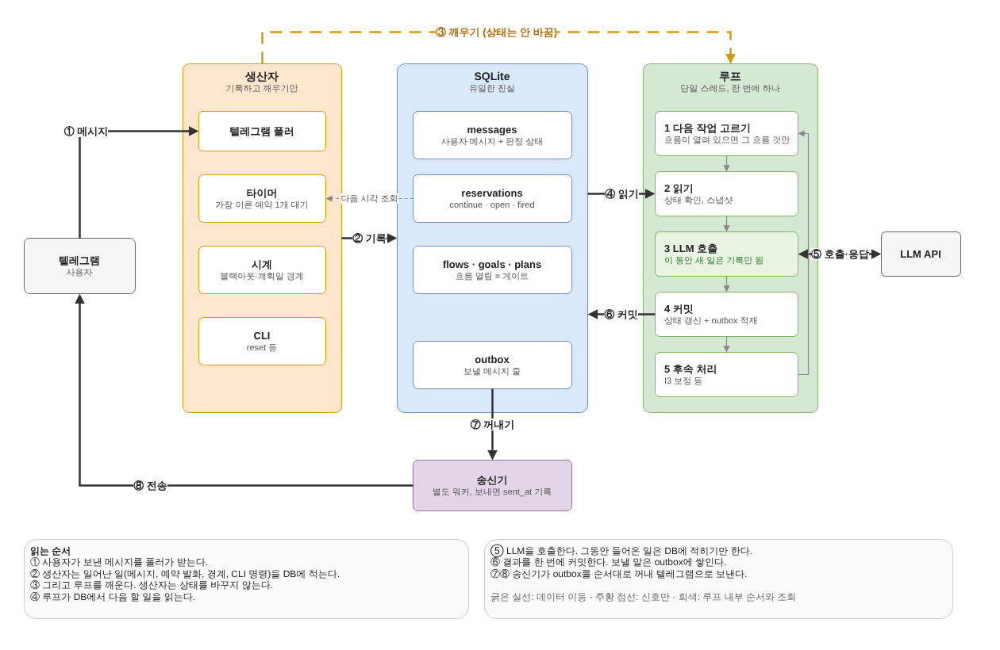
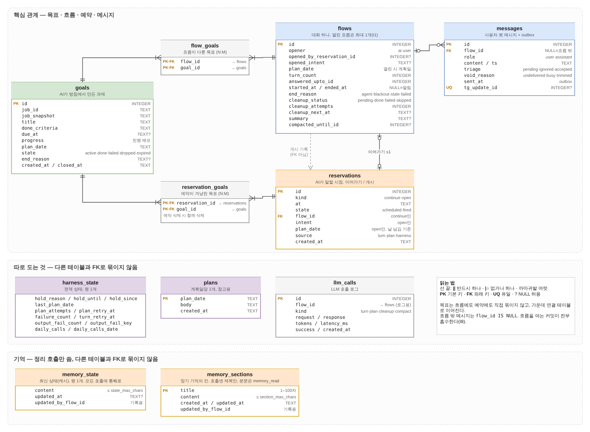

# aigan 하네스 설계 v4 (골격)

- 상태: 초안. 골격(§1–§7) 합의 후 DB 스키마(§8), 워커 의사코드(§9), 테스트 목록(§11)을 붙였다. 이어서 기억 설계(§5.6, §8.7)와 하루 규칙(원칙 7, §4.2 날 넘김)을 붙였다. 다음은 프롬프트 본문.
- 참고: `harness-design.md`(v3.0), `harness-trace.md`. v3는 버리지 않고 실행 계층의 참고로 쓴다(§6).

---

## 1. 기획 의도

### 1.1 배경

퇴근 후 피로와 숏폼으로 시간을 흘려보내는 일이 반복되며 우울감·무능감이 생겼다. 할 일을 몰라서가 아니라 늘어진 상태를 깨는 힘이 없어서다. 기존 코칭 앱은 "정해진 시각에 알림 + 체크리스트 + 통계"에 그쳐, 무시해도 아무 일이 없으므로 결국 무시하게 된다.

aigan은 알림이 아니라 **개입**을 한다. 적절한 일을 골라 시키고, 끝까지 붙어서 실제로 하게 만든다.

### 1.2 요구사항

| # | 요구사항 | 하네스가 지켜야 할 조건 |
|---|---|---|
| R1 | 다양한 행동 지시 | 등록 대상은 할 일이 아니라 **행동 방침**이다. 구체 목표와 완료 조건은 AI가 방침에서 생성한다. |
| R2 | 목표 달성까지 이어지는 흐름 | 흐름은 AI가 끝내기로 할 때까지 산다. 사용자가 반응하지 않아도 AI가 다시 말을 건다. 서브태스크 단위 지시가 가능하다. |
| R3 | 비동기 목표 | 목표의 수명은 흐름과 독립이다. 목표 하나에 여러 흐름(지시·중간보고·최종보고)이 시간차로 붙는다. 단 계획일을 넘지 않는다(원칙 7). |
| R4 | 사용자도 흐름을 연다 | 흐름이 없을 때 온 사용자 메시지는 AI가 읽고 **받을지 판단**한다. 받지 않으면 완전히 무시한다. |

### 1.3 전제

- 사용자 1명, 텔레그램 봇, 로컬 단일 프로세스. 리셋은 오프라인 CLI.
- 프롬프트(방침·상위 프롬프트·턴 규칙)의 수정은 대화가 아니라 시스템 수정(파일 편집 후 재시작)으로 한다.
- 완료 판정 기준과 압박 수위는 프롬프트로 조정한다. 하네스는 판정을 LLM에 맡기고 결과만 상태에 반영한다.

### 1.4 원칙

1. **대화는 하나.** 활성 흐름은 최대 1개다. 흐름 뒤에 바로 다음 흐름이 올 수는 있지만 겹치지 않는다.
2. **판단은 LLM, 강제는 하네스.** 무엇을 시킬지·받을지·언제 다시 말할지는 LLM이 정한다. 하네스는 그 결정이 불변식을 깨지 않게 검증하고, 결정이 없거나 무효면 안전한 기본값으로 메운다.
3. **잊히는 목표는 없다.** 살아 있는 목표는 언젠가 다시 다뤄질 자리(예약 또는 열린 흐름)를 반드시 갖는다.
4. **상태는 워커만 바꾼다. 큐는 휘발성, 진실은 DB.** (v3 원칙 유지)
5. **한 턴 = 한 트랜잭션.** 턴의 모든 효과(목표 변경·예약·메시지 저장·흐름 종료)는 함께 커밋되거나 함께 버려진다. (v3 TurnTx 유지)
6. **말하지 않은 턴은 상태를 바꾸지 않는다.** 메시지를 하나도 보내지 않은 턴의 도구 효과는 하네스가 버린다. 그래서 목표와 개입 일정은 사용자가 무언가를 받는 턴에서만 바뀐다. 말 없는 턴에 남는 것은 자기 트리거의 소비(개시 예약 삭제, 이어가기 교체, 미응답 처리, `ignored` 표시), 흐름 종료, 하네스 보정뿐이다. 보낸 메시지가 그 변경을 실제로 알리는지는 프롬프트의 몫이다.
7. **하루 안에 끝낸다.** 목표와 개시 예약은 자기 계획일을 넘지 않는다. 계획일 경계는 블랙아웃 시작이다. Agent가 사용자를 움직여 무언가를 하려면 가능하면 지금, 늦어도 그날 안이어야 하고, 기다려 주는 일이 길어질수록 할 일이 흐려진다. 날을 넘긴 활성 목표는 하네스가 `expired`로 닫고(§4.2 날 넘김), 여러 날에 걸친 일은 방침이 날마다 그날 몫의 목표를 새로 만든다. 날 사이의 연속성은 기억(§5.6)과 계획이 맡는다. **블랙아웃은 대화가 없는 시간이다.** 열린 흐름은 블랙아웃 시작에 닫히고, 그동안 온 사용자 메시지는 블랙아웃이 끝난 뒤 다룬다(§4.3). 그래서 흐름은 계획일을 넘지 않는다.

---

## 2. 개체 모델

```
행동 방침 (설정, 읽기 전용)
   │ 1:N  (턴에서 AI가 생성)
   ▼
목표 ◀──── N:M (흐름이 다룬 목표) ────▶ 흐름 ──1:N──▶ 메시지
   ▲                                       ▲
   │ N:M (예약이 겨냥하는 목표, 선택)        │ 개시 / 이어가기
   └───────────────── 예약 ─────────────────┘

하루 계획 (계획일당 1개, 참고용)
사용자 기억 (state 1개 + 칸 N개, 정리 호출만 씀)
```

### 2.1 행동 방침 (`jobs`)

- 방침 하나가 파일 하나다: `prompts/jobs/<id>.md`. 파일명이 `id`이고, frontmatter의 `description`(한두 줄 설명)과 본문으로 이뤄진다. 런타임에는 읽기만 한다.
- 필드: `id`, `description`, `prompt`(방침 본문). 빈도·시간대 같은 메타 필드는 두지 않는다.
- **추가·수정·삭제는 파일을 넣거나 고친 뒤 재시작한다.** 다른 방침 파일이나 하네스 코드는 건드리지 않는다. 계획은 계획일당 한 번이라, 바뀐 방침이 계획에 반영되는 것은 다음 계획일부터다. 턴의 방침 목록에는 재시작 직후부터 보인다.
- **LLM에는 본문 대신 목록(`id`·`description`)을 준다.** 방침이 늘어도 매 호출의 입력이 본문만큼 커지지 않게 하기 위해서다. 본문은 필요할 때만 들어간다: 턴이 `job_read`로 열고(새 목표를 만들 때), 활성 목표는 자기 `job_snapshot`을 함께 보인다(평가 기준).
- **상위 프롬프트**(방침 선정 규칙)가 별도로 있어 "어떤 방침을 언제 얼마나 자주"를 정한다. 상위 프롬프트는 특정 방침 `id`를 적지 않고 일반 규칙만 둔다. 계획은 `description`만 보므로, 빈도·시간대처럼 배치에 필요한 정보는 `description`에 쓴다("평일 저녁, 하루 한 번").
- 방침 파일에서 사라진 `id`를 가리키는 목표는 그대로 살아 있다(목표는 생성 시점의 방침 본문을 `job_snapshot`으로 복사해 둔다).

### 2.2 목표 (`goals`)

AI가 방침에서 만든 구체 과제. 여러 개가 동시에 살아 있을 수 있다.

- 필드(개념): `job_id`, `title`, `done_criteria`(완료 조건), `due_at`(선택, 그날 안의 마감), `progress`(AI가 갱신하는 진행 메모·서브태스크 계획), `plan_date`(생성 시점의 현재 계획일), `state`, `end_reason`.
- 상태:

```
active ──▶ done      (AI가 완료로 판정)
   │──────▶ failed    (AI가 실패로 판정. 마감 경과 포함)
   │──────▶ dropped   (AI가 철회. 상황 변화, 중복 등)
   └──────▶ expired   (하네스. 계획일이 끝날 때까지 AI가 닫지 않음)
```

- **생성·변경은 흐름의 턴 안에서만** 한다. 목표는 사용자에게 지시되는 순간 생기기 때문이다. 계획 작업은 목표를 만들지 않는다(§2.6).
- 마감(`due_at`)은 자기 계획일의 깨어 있는 구간 안이어야 한다(블랙아웃 끝 이후, 그날 끝 이전). 블랙아웃 안의 마감은 확인할 개시 예약을 놓을 수 없어서다. 마감이 지나도 하네스가 자동으로 `failed`로 바꾸지 않는다. 마감 시각의 예약이 흐름을 열고, 그 턴에서 AI가 판정한다.
- 계획일이 끝날 때까지 닫히지 않은 목표는 날 넘김(§4.2)이 `expired`로 닫는다. AI가 내린 실패(`failed`)와 손대지 못한 것(`expired`)은 다른 정보라 상태를 나눈다. 다음 날 계획이 최근 종료 목표로 이것을 본다.
- 서브태스크는 별도 개체로 두지 않는다. 진행 메모(`progress`)에 AI가 계획·현황을 쓰고, 흐름 안의 이어가기 예약으로 한 단계씩 지시한다.
- 동시 활성 목표 수에 상한(`goal_max_active`)을 둔다. 초과 생성은 도구 거부.

### 2.3 흐름 (`flows`)

대화 하나. 특정 목표에 묶이지 않고, 한 흐름에서 여러 목표를 다룰 수 있다.

- 필드(개념): `opener`(`ai` | `user`), `opened_by_reservation`(AI 개시일 때), `plan_date`(열린 시점의 현재 계획일), `answered_upto_id`(v3 유지), `state`(`open` | `closed`), `end_reason`.
- **흐름-목표 연결**(`flow_goals`)은 그 흐름을 연 개시 예약이 겨냥한 목표(`goal_ids`)와, 그 흐름의 턴이 생성·갱신·종료한 목표를 기록한다. 추적·회고와 정리 입력의 표시(§5.3)에 쓰며 동작을 제약하지 않는다.
- 종료 사유:

| `end_reason` | 원인 |
|---|---|
| `agent` | AI가 턴 출력으로 종료 |
| `blackout` | 블랙아웃 시작(§4.3). 미응답이 있어도 닫는다 |
| `stale` | 재시작·보류 해제 후 이어가기 예약이 `stale_after_sec`보다 낡음 |
| `failed` | 흐름 안 턴이 출력 실패를 `turn_max_attempts`번 연속 냄(§9.4 `fail_turn`) |

### 2.4 예약 (`reservations`)

미래의 "AI가 말할 시점". 두 종류다.

| 종류 | 의미 | 개수 | 생성 |
|---|---|---|---|
| **이어가기**(`continue`) | 열린 흐름의 다음 턴. 사용자 무응답 시 재촉·다음 서브태스크 지시. | 열린 흐름당 정확히 1개 | 턴 출력(필수), 하네스 복구 |
| **개시**(`open`) | 새 흐름을 여는 개입 | 상한 `open_max_pending` | 턴 도구, 계획 작업, 하네스 보정(§3 I3) |

- 개시 예약 필드(개념): `at`, `intent`(이 개입에서 하려는 것, 자연어), `goal_ids`(선택. 중간보고·최종보고처럼 특정 목표를 겨냥할 때), `plan_date`, `source`(`turn` | `plan` | `harness`).
- 상태: `scheduled` → `fired` → (흐름 개시 또는 취소) → 삭제. `fired`인데 흐름이 열려 있으면 그대로 대기한다(v3 deferred).
- **시각 범위**(원칙 7). 계획일 `D`의 깨어 있는 구간은 `[블랙아웃(D)의 끝, 블랙아웃(D+1)의 시작)`이고, 뒤쪽 끝을 **그날 끝**이라 부른다. v3의 `max_lead` 클램프는 그날 끝이 대신한다.
  - 개시 예약: `at`은 현재 계획일의 깨어 있는 구간 안. 앞쪽은 `max(now+min_lead, 블랙아웃 끝)`으로 당기고(늦게 돈 턴이 낸 과거 시각도 버리지 않음), 그날 끝 이후면 도구는 거부하고 계획 출력은 버린다(로그). 그래서 개시 예약은 블랙아웃 안에 놓이지 않는다.
  - 이어가기 예약: `clamp(now+min_lead, 흐름의 계획일 끝)`. 그날 끝 이후는 쓸 일이 없다. 흐름이 블랙아웃 시작에 닫히기 때문이다(§4.3).
- AI는 턴 도구로 개시 예약을 만들고 취소할 수 있다. 밀린(deferred) 개시 예약을 합치거나 버리는 판단도 이 도구로 한다.
- 지난 계획일의 개시 예약은 발화 여부와 무관하게 날 넘김(§4.2)이 지운다. 다음 날 할 일은 다음 날 계획이 기억과 최근 종료 목표를 보고 다시 잡는다.

### 2.5 메시지 (`messages`)

- 흐름 안의 메시지와 흐름 밖의 사용자 메시지를 모두 기록한다.
- 흐름 밖 사용자 메시지에는 판정 결과를 붙인다: `pending`(판정 전) → `accepted`(흐름이 열림) | `ignored`(무시).
- **흐름 경계에서 메시지 이동**(I8):
  - 흐름을 여는 커밋 tx는 그 시점의 흐름 밖 메시지를 전부 흐름으로 옮긴다(`pending`은 `accepted`, `ignored`는 그대로). 무시한 메시지가 다음 흐름 대화에 남는 방식이 이것이다. 개시 턴 io 중에 온 메시지도 여기 포함되며, 턴이 보지 못한 것은 미응답으로 남아 디바운스 턴이 답한다.
  - 흐름을 닫는 tx는 미응답(`id > answered_upto_id`)을 흐름 밖 `pending`으로 옮긴다(v3 `close_flow` 4단계). 닫는 턴 io 중에 온 메시지가 여기 해당한다.
- **무시한 메시지도 다음 흐름의 컨텍스트에 포함한다.** "아까 끝났다고 했잖아"를 막기 위함이다. 무시는 "응답하지 않음"이지 "모름"이 아니다.
- **흐름 밖 메시지는 최근 `outside_messages_max`개만 쓴다.** 밤새 무시한 메시지가 쌓여도 입력이 끝없이 커지지 않게 한다. 턴 입력에는 최근 N개와 "(이전 흐름 밖 메시지 K개 생략)"만 넣고, 흐름을 여는 커밋은 N개 밖의 것을 옮기면서 `void_reason='trimmed'`로 표시한다(기록은 남고 컨텍스트·정리 입력에서 빠짐).
- **턴 처리 중 온 메시지는 받지 않는다.** 턴 io 동안(도구 라운드·되묻기 포함) 온 사용자 메시지는 폴러가 텔레그램에서 지우고(`deleteMessage`, 봇은 개인 대화의 받은 메시지를 지울 수 있다) `void_reason='busy'`로 기록만 한다. 사용자에게는 보낸 메시지가 사라지는 것으로 보이고, io 동안 "입력 중" 표시(`sendChatAction typing`)가 떠 있어 이유를 알 수 있다. 메시지가 AI 답장보다 먼저 저장돼 "이미 답한 것처럼" 보이는 순서 문제(텔레그램에서 막을 수 없음)를 없앤다. 지우기가 실패하면 평소처럼 받는다(아래 경계 이동 규칙대로 미응답이 된다).
- 전송은 outbox(`sent_at`)로 한다(v3 유지).

### 2.6 하루 계획 (`plans`)

- 계획일당 1개. 상위 프롬프트·방침·활성 목표·최근 종료 목표·사용자 기억을 보고 AI가 하루 개입 구상(자연어)과 개시 예약 몇 개를 낸다.
- **참고용이다.** 계획 본문은 이후 턴의 컨텍스트에 들어갈 뿐, 지켜야 할 일정이 아니다. 실제 개입 시점은 개시 예약이 정한다.
- 목표를 만들지 않는다. 계획이 낸 개시 예약은 `intent`만 갖고, 목표는 그 흐름의 턴에서 생긴다.
- 계획은 날 넘김 뒤에 돌므로 이전 계획의 예약은 이미 지워져 있다. 그래서 계획은 예약을 교체하지 않고 더하기만 한다.
- 실행 시점·실패 재시도는 v3 계획일 규칙을 따른다(블랙아웃 끝 날짜 = 계획일, 실패 시 `plan_retry_at` 백오프).

### 2.7 사용자 기억 (`memory`)

- AI가 사용자에 대해 쌓는 분석이다. 두 층으로 나눈다.
  - **state**: 최신 상태. 캐시처럼 짧게 유지하고 모든 호출에 통째로 들어간다.
  - **칸**: 구조화된 장기 기억. 제목과 본문의 쌍이고, 호출에는 제목 목록만 들어간다.
- 쓰기는 흐름이 닫힌 뒤 정리 호출만 한다. 흐름 전체를 보고 정리하는 편이 낫고, 흐름 도중에는 기억이 바뀌지 않는다. 상세는 §5.6.

---

## 3. 불변식

| # | 내용 | 비고 |
|---|---|---|
| I1 | 활성 흐름은 최대 1개 | v3 (c) |
| I2 | 열린 흐름은 턴 실행 중이 아니면 이어가기 예약을 정확히 1개 가진다 | v3 (d) |
| I3 | `active` 목표는 열린 흐름에서 다뤄지는 중이거나, 자신을 `goal_ids`에 포함한 개시 예약을 1개 이상 가진다. 예외: 그날 남은 시간이 없어 예약을 놓을 수 없는 목표(날 넘김이 `expired`로 닫는다) | 신규. 원칙 3 |
| I4 | 목표의 생성·변경은 턴 트랜잭션 안에서만 일어난다 | 신규 |
| I5 | 개시 예약의 `at`은 자기 계획일의 깨어 있는 구간 안에 있다(그래서 블랙아웃 안에 놓이지 않는다) | v3 블랙아웃 규칙 + 원칙 7 |
| I6 | `source≠harness`인 대기 개시 예약 수 ≤ `open_max_pending`, 활성 목표 수 ≤ `goal_max_active` | 신규 상한. 보정 예약은 제외(활성 목표 수로 이미 묶임) |
| I7 | 다음 시스템 작업(계획)을 깨울 타이머가 항상 무장돼 있다 | v3 (a) |
| I8 | 흐름이 열려 있으면 흐름 밖 사용자 메시지는 없다(`pending`·`ignored` 모두) | 신규. §2.5 경계 이동 |
| I9 | 흐름이 없고 정리가 끝났으면 지난 계획일의 활성 목표와 개시 예약은 없다. 보류 중은 제외(날 넘김도 멈춘다) | 신규. 원칙 7, §4.2 날 넘김 |

**I3 보정**: 흐름이 닫힐 때(어떤 사유든) 하네스가 I3를 검사한다. 걸린 목표가 있으면 개시 예약을 하네스가 만든다(`source='harness'`, `at`은 `due_at`이 미래면 `due_at`, 없거나 지났으면 `now + orphan_goal_delay`, 단 그날 끝 직전을 넘지 않음, `intent`는 "후속 확인"). 그날 끝에 가까운 보정은 "마감 직전 최종 확인"이 된다. 지난 계획일의 목표와 그날 남은 시간이 없는 목표는 건너뛴다(날 넘김이 닫는다). 시각은 AI가 정하는 것이 원칙이라, AI가 판단할 수 있는 지점(흐름을 끝내는 턴, 말 없는 개시 턴)에서는 빠뜨리면 하네스가 출력을 되돌려 다시 묻는다(§9.4 되묻기). 보정은 LLM이 없는 종료(`blackout`, `stale`, `failed`), 트리거 포기, 되물어도 또 빠뜨린 경우에만 일어나는 안전망이다. 보정이 일어나면 로그에 남겨 프롬프트 개선 신호로 쓴다. 보정 예약은 `open_max_pending`에 걸리지 않는다(I6).

---

## 4. 이벤트와 반응

### 4.1 이벤트 표

| 이벤트 | 흐름 없음 | 흐름 열림 |
|---|---|---|
| 개시 예약 발화 | 흐름을 열고 개시 턴(§4.2) | `fired`로 대기. 흐름이 닫히면 순서대로 처리 |
| 이어가기 예약 발화 | (발생 불가: I2) | 이어가기 턴 |
| 사용자 메시지(디바운스 만료) | 수신 판정(§4.4). 블랙아웃 중이면 끝난 뒤 | 흐름에 포함, 다음 턴(즉시) |
| 이어가기 발화 중 디바운스 대기 | (발생 불가) | 디바운스 만료까지 미룬다. 만료 시 턴 하나가 둘 다 처리. 반쪽 입력에 답하지 않기 위함 |
| 블랙아웃 진입 = 계획일 경계 | 날 넘김 → 계획 작업 | 흐름을 `blackout`으로 닫고(§4.3) 정리 → 날 넘김 → 계획 |
| 블랙아웃 끝 | 블랙아웃 중 쌓인 `pending` 처리(§4.2 순서) | (발생 불가: 블랙아웃 중 흐름 없음) |
| 보류 진입·해제 | v3 보류 게이트 + `resume()` | 동일 |

### 4.2 흐름이 닫힌 뒤 처리 순서

흐름이 닫히면(또는 흐름 없는 상태에서 이벤트가 오면) 0번을 먼저 끝내고, 날 넘김을 처리한 뒤, 1~3 중 하나만 실행한다. 새 흐름이 열리면 그 흐름이 닫힐 때 다시 여기로 온다.

0. **방금 닫힌 흐름의 정리**(§5.3). 끝나기 전에는 1~3을 실행하지 않는다. 그동안 온 사용자 메시지는 `pending`으로 쌓인다. 실패하면 짧은 백오프로 `cleanup_max_attempts`회까지 재시도하고, 끝내 실패하면 `failed`로 표시하고 운영자 알림을 남긴 뒤 넘어간다.
- **날 넘김**(LLM 없음). 지난 계획일(`plan_date < 현재 계획일`)의 활성 목표를 `expired`로 닫고(`end_reason`="날 넘김"), 지난 계획일의 개시 예약을 상태와 무관하게 지운다. 데이터로 판정하므로 플래그가 없고 몇 번 돌아도 같다. 열린 흐름은 블랙아웃 시작에 닫히므로 날 넘김은 그 흐름의 정리 직후에 돈다. 오래 꺼져 있다 켜져도 어제 개입이 오늘 계획보다 먼저 돌지 않는다.
1. **밀린 개시 예약**(`fired`, `at` 순). 개시 전 사전 검사: `goal_ids`가 있고 모두 종료됐으면 삭제하고 다음 것을 본다. 개시 예약은 블랙아웃에 놓이지 않으므로(I5) 블랙아웃 중에 발화해 남은 것은 지난 날의 것이고, 날 넘김이 이미 지웠다.
2. **판정 대기 사용자 메시지**(`pending`) → 수신 판정. 블랙아웃 중에는 하지 않는다.
3. **밀린 계획 작업**.

**합류 규칙**: 개시 턴은 직전 흐름 이후의 흐름 밖 사용자 메시지(판정 대기·무시 포함)를 컨텍스트에 포함한다. 그래서 1번이 실행되면 2번의 `pending` 메시지는 그 흐름에 흡수(`accepted`)되고 별도 판정을 하지 않는다. AI가 연 흐름에서 "아까 말한 거 봤어"가 자연스럽게 나온다. 흡수된 메시지를 턴이 언급하지 않으면 판정에서 무시한 것과 같으므로, 흡수는 판정 기회를 빼앗지 않는다. 별도 상태로 구분하지 않는다.

**밀린 개입 정보**: 모든 턴(개시·이어가기·흐름 내 응답)의 컨텍스트에 "발화했지만 대기 중인(`fired`) 개시 예약 목록"을 넣는다. AI는 이번 흐름에서 함께 다루고 그 예약을 취소하거나, 지금 흐름을 마무리해 넘기거나, 그대로 둘 수 있다. 하네스는 합치기를 직접 하지 않는다. 흐름이 열린 동안 다른 개입이 밀린다는 사실을 AI가 알아야, 흐름 종료 시점을 AI에 맡길 수 있다(§7 흐름 길이).

### 4.3 블랙아웃

블랙아웃은 대화가 없는 시간이다(원칙 7). v3는 "시스템이 먼저 말 걸기"만 금지했지만, v4는 사용자가 건 말에도 답하지 않는다. 블랙아웃 중에 도는 것은 LLM 없는 작업과 정리·계획뿐이다.

- 개시 예약: 애초에 블랙아웃에 놓이지 않는다(I5). 블랙아웃 직전에 발화해 밀린 것은 날 넘김이 지운다.
- 열린 흐름: 블랙아웃 시작에 LLM 없이 `blackout`으로 닫는다. 미응답은 흐름 밖 `pending`으로 옮겨진다(`close_flow` 4단계). 마무리 인사는 프롬프트가 그날 끝(이벤트 블록)을 보고 미리 한다.
- 블랙아웃 시작을 넘겨 io 중인 턴: 흐름 안 턴과 사용자 개시 턴은 끝까지 커밋하고 보낸다(직전에 온 말에 대한 답). 흐름은 그 직후 닫힌다. AI 개시 턴은 커밋 시점이 블랙아웃이면 말없이 취소한 것으로 처리한다(먼저 말 걸기 금지). §9.4.
- 사용자 메시지: 저장만 하고 판정하지 않는다. 블랙아웃이 끝나면 §4.2 순서대로 아침 첫 개시 턴이 흡수하거나 판정 턴이 받는다. 밤에 한 말("내일 일찍 운동할게")은 이렇게 아침에 쓰인다. 지우지 않는 이유: 그 말 자체가 정보다.
- 그래서 흐름은 계획일을 넘지 않고, 턴 입력의 "오늘"은 언제나 그 턴의 계획일 하나다(§5.1).

### 4.4 수신 판정

흐름이 없을 때 온 사용자 메시지(디바운스로 묶음)에 대해 AI가 받을지 정한다. 블랙아웃 중에 온 것은 블랙아웃이 끝난 뒤 판정한다(§4.3).

- **받음**: 흐름을 열고(`opener='user'`) 사용자 개시 턴을 실행. "지금은 아님" 같은 짧은 답도 받은 것이다(흐름이 열리고 바로 닫힐 수 있다).
- **무시**: 아무것도 보내지 않는다. 메시지는 `ignored`로 남고 다음 흐름의 컨텍스트에 들어간다.
- 판정은 턴 호출과 **같은 호출**로 한다. 사용자 개시 턴이 메시지를 0개 내면 무시다(원칙 6, 별도 `respond` 필드 없음). 흐름 생성은 커밋 tx에서만 하고 pre는 읽기만 하므로, 무시면 커밋 tx가 메시지를 `ignored`로 표시하는 것 말고는 아무것도 쓰지 않는다. 별도 경량 판정 호출은 비용 최적화로 나중에 검토한다.
  - 같은 호출이어야 하는 이유: 판정에 필요한 컨텍스트(활성 목표·최근 대화·계획)가 턴과 같고, 두 단계로 나누면 "받았는데 턴에서 다른 판단" 같은 불일치가 생긴다.

---

### 4.5 실행 모델

JS 이벤트 루프를 본뜬 단일 루프.



원본: [`harness-exec-model.drawio`](harness-exec-model.drawio)

- **생산자**(텔레그램 폴러, 타이머, 시계, CLI)는 사실을 DB에 기록하고 루프를 깨우기만 한다. 상태 전이는 하지 않는다. 타이머는 "다음 기한" 하나만 조준하고, 관련 쓰기 직후 다시 맞춘다. 다음 기한 = `MIN(개시·이어가기 예약 at, 디바운스 만료, hold_until, 정리 재시도 시각, 계획 시점)`.
- **루프**는 한 번에 작업 하나만 처리한다.
  1. 다음 작업 선택: 흐름이 열려 있으면 그 흐름의 답장·이어가기만, 닫혀 있으면 §4.2 순서.
  2. pre(동기 tx): 상태 확인, 스냅샷.
  3. io(비동기): LLM 호출. 이 동안 들어온 이벤트는 기록만 되고 처리하지 않는다(인터리빙 없음).
  4. commit(동기 tx): TurnTx 반영, outbox 적재.
  5. 전송: 커밋 직후 루프가 outbox를 `id` 순으로 보내고 `sent_at`을 기록한다. 분할·`send_interval`·429·403(`blocked` 보류) 처리는 v3 §9.4 6단계 그대로. 커밋 후 전송 전 크래시는 재시작 때 outbox 재전송, 낡은 것은 `undelivered`(v3).
  6. 후속 처리를 끝까지 소진한 뒤 1로. I3 보정, 흐름이 닫혔으면 정리(§4.2 0번).
- 전송을 별도 워커로 빼지 않는 이유: 빼면 이전 턴 메시지가 나가기 전에 다음 턴이 돌 수 있고(사용자가 못 본 말을 본 걸로 가정), 403 보류가 루프와 어긋난다. 단일 사용자라 전송 대기로 루프가 막히는 비용은 작다.
- **작업 단위**: 연달아 온 사용자 메시지는 디바운스로 묶어 턴 하나. 나머지 이벤트는 이벤트 하나가 작업 하나.
- **흐름 = 게이트**: 흐름은 사용자 답장을 기다리는 시간까지 루프를 점유한다. 그 사이 발화한 개시 예약은 끼어들지 않고 `fired`로 보류된다(§4.1). 정리·계획도 흐름이 열린 동안에는 돌지 않는다.
- **턴 중 도착한 메시지**: 턴 io 중에 온 사용자 메시지는 텔레그램에서 지우고 받지 않는다(§2.5). 지우기에 실패한 것만 그 턴에 반영되지 않은 채 `answered_upto_id` 이후 미응답으로 남아 다음 턴의 입력이 된다.
- 큐의 진실은 DB다. 메모리 큐는 부팅 때 DB에서 재구성하는 캐시다(v3).

## 5. LLM 접점

하네스가 LLM과 주고받는 호출은 셋이다. 프롬프트 본문은 이 문서의 범위가 아니며, 각 호출의 입력 슬롯과 출력 계약만 정한다.

### 5.1 턴

| 항목 | 내용 |
|---|---|
| 계기 | 개시(AI·사용자), 이어가기, 흐름 내 사용자 메시지 |
| 입력 | 턴 규칙 프롬프트, 방침 목록(`id`·`description`), 활성 목표(진행 메모, `job_snapshot`, 그 목표에 걸린 개시 예약의 id·at·intent 포함), 오늘 종료된 목표(결과·사유), 오늘 계획(아직 없으면 "(계획 전)"), 직전 흐름 꼬리, 흐름 대화, 직전 흐름 이후 흐름 밖 메시지(최근 `outside_messages_max`개), 이벤트 블록(계기·이 흐름을 연 개시 예약의 `intent`·밀린(`fired`) 개시 예약 목록·현재 시각·오늘의 끝), 기억(state 전문, 칸 제목 목록) |
| 출력 | 보낼 메시지(0개 이상), 다음(`continue at` \| `end`) |
| 도구 | `job_read`(id), `memory_read`(title), `goal_create`, `goal_update`(진행 메모·마감), `goal_close`(done/failed/dropped + 사유), `open_reserve`(at, intent, goal_ids), `open_cancel` |

- `continue at`이 무효(과거·그날 끝 이후·누락)면 클램프한다(§2.4).
- **"오늘"의 기준**: 턴의 계획일. pre에서 현재 계획일로 고정하고 입력·도구 검증·커밋이 모두 이 값을 쓴다(§9.4). 흐름은 블랙아웃 시작에 닫히므로(§4.3) 흐름의 계획일과 같다. 오늘 종료된 목표, 오늘 계획, 오늘의 끝이 이 기준을 따른다.
- **직전 흐름 꼬리**: 기준 시각보다 `prev_flow_tail_max_age_sec` 안에 앞서 닫힌 흐름이 있으면, 그 흐름의 마지막 `prev_flow_tail_messages`개 메시지. 기준 시각은 이 흐름의 첫 메시지 시각이고, 흐름이 없으면 흐름 밖 메시지 중 가장 이른 것, 그것도 없으면 지금이다. 닫히는 메시지에 대한 답("응 근데 하나만")이 흐름 밖으로 옮겨져 판정될 때, 그리고 방금 닫힌 대화를 이어 말할 때 무엇에 대한 말인지 알게 한다. 처리 시각이 아니라 메시지 시각으로 재는 이유: 블랙아웃 직전에 닫힌 흐름에 대한 답(22:58 "내일 첫 할 일 정해" → 23:06 "운동")은 블랙아웃이 끝난 아침에 처리된다. 흐름을 연 메시지가 그 답이면 그 흐름의 이후 턴도 같은 꼬리를 본다. 앞서 닫힌 흐름이 오래전(전날 저녁 흐름에 대한 아침의 새 말)이면 시간 제한으로 빠진다.
- 이 흐름을 연 개시 예약의 `intent`(`opened_intent`)는 첫 턴만이 아니라 그 흐름의 모든 턴에 넣는다.
- 이 턴으로 흐름이 없어지는데(`end`, 또는 개시 턴의 메시지 0개) 다음 확인이 없는 활성 목표가 남으면, 하네스가 그 목표를 알려 주고 한 번 되묻는다(§9.4). AI는 `open_reserve`로 시각을 잡거나 `goal_close`한다.
- 메시지 0개면 도구 효과를 버린다(원칙 6).
  - 개시 턴: 흐름을 열지 않는다. AI 개시면 "개입 취소", 사용자 개시면 "무시"다. `next`는 보지 않는다.
  - 흐름 안 턴: `continue`는 조용히 기다림, `end`는 말없이 흐름 종료.
- 개입을 미루고 싶으면 한 줄이라도 말하고 `open_reserve`한다("회의 중이구나, 4시에 다시 올게").
- 그날 끝 이후로는 미룰 수 없다(원칙 7). 다음 날 다시 다룰 것은 말로 남기면 정리가 기억에 옮기고, 다음 날 계획이 그것을 본다.

### 5.2 계획

| 항목 | 내용 |
|---|---|
| 계기 | 계획일 도래(v3 계획일 규칙) |
| 입력 | 상위 프롬프트, 방침 목록(`id`·`description`), 활성 목표, 최근 종료 목표(지난 `recent_goal_days`일, 제목·`job_id`·결과·사유·종료 시각. 직전 계획일의 `expired` 목표는 진행 메모도), 기억(state 전문, 칸 제목 목록), 남아 있는 개시 예약 |
| 출력 | 계획 본문(자연어), 개시 예약 목록(at, intent, goal_ids 선택) |
| 도구 | `memory_read`(title) |

- 개시 예약은 시각 범위 규칙(§2.4)을 거쳐 저장된다. 그날 끝 이후는 버린다(로그). 상한을 넘으면 `at`이 이른 순으로 상한까지 저장하고 나머지는 버린다(로그). 기존 예약은 건드리지 않는다. 이전 계획의 예약은 날 넘김이 이미 지웠다.

### 5.3 정리

| 항목 | 내용 |
|---|---|
| 계기 | 흐름이 닫힌 직후, 다음 흐름이 열리기 전(§4.2 0번) |
| 입력 | 정리 규칙 프롬프트, 기억(state 전문, 칸 제목 목록), 그 흐름의 대화 원문, 목표(흐름의 계획일 목표 전체와 `flow_goals`의 목표: 제목·완료 조건·`job_id`·상태·진행 메모·종료 사유, `flow_goals`에 있으면 "이 흐름에서 다룸" 표시), 흐름 정보(개시자·`opened_intent`·시작·종료 시각·종료 사유), 현재 시각 |
| 출력 | 없음. 도구 효과가 결과다 |
| 도구 | `memory_read`(title), `state_write`(content), `memory_write`(title, content), `memory_delete`(title) |

- 상태: `pending` → `done` / `failed` / `skipped`(정리 규칙 파일 없음). 흐름은 말을 한 턴만 열므로 메시지 없는 흐름은 없다. 사용자가 끝내 답하지 않은 흐름도 정리한다(무응답 자체가 기록할 정보다).
- 목표를 `flow_goals`로만 고르지 않고 그 계획일 목표 전체를 준다. 하루에 살아 있는 목표는 `goal_max_active`개 이하라 작고, 진행 메모를 고치지 않은 채 중간보고만 받은 목표도 빠지지 않는다. 턴 입력의 목표 구성과도 같다.
- 대화는 압축본이 아니라 원문을 준다. 압축이 버린 세부(두 번째 오답의 내용 같은 것)가 기록에는 필요하고, 정리는 흐름당 1회라 비용이 작다. 원문이 `cleanup_raw_max_chars`를 넘을 때만 턴과 같은 압축본(`summary` + 비압축 구간)으로 대체한다.
- 흐름 밖에서 왔다가 이 흐름으로 옮겨진 메시지 중 `triage='ignored'`인 것에는 "(무시됨)" 표시를 붙인다. 무시한 메시지도 이렇게 기억에 남을 수 있다(J2).
- 진행 메모의 이력은 따로 두지 않는다. 덮어쓰기 전 과정("1차 반려, 2차 반려")은 대화 원문에 있다.
- 진행 메모는 다음 날로 넘어가지 않는다(원칙 7). 다음 날 이어야 할 것("내일 같은 유형 재도전", "책 120쪽까지")은 정리가 기억에 옮긴다. `cleanup-rules.md`가 이 책임을 적는다.
- persona는 넣지 않는다. 말투와 무관한 기록 작업이다.

### 5.4 공통

- 출력은 스키마 검증(zod). 파싱 실패 시 1회 재시도 후 실패 처리(v3 백오프).
- LLM 호출 직전 보류 게이트(v3).

### 5.5 프롬프트 파일

```
prompts/
├── persona.md        # 누구인가: 말투, 압박 수위, 의심하는 태도
├── turn-rules.md     # 하네스를 어떻게 쓰나: 출력·도구·예약 규칙
├── plan-rules.md     # 상위 프롬프트: 방침 선정·빈도·배치의 일반 규칙
├── cleanup-rules.md  # 흐름이 닫힌 뒤 기억에 무엇을 남기나, 칸을 어떻게 나누나
├── compact-rules.md  # 긴 대화 요약
└── jobs/
    └── <id>.md       # 방침. frontmatter description + 본문(§2.1)
```

| 파일 | 필수 | 턴 | 계획 | 정리 | 없으면 |
|---|---|---|---|---|---|
| `persona.md` | 선택 | 통째로 | - | - | 건너뜀 |
| `turn-rules.md` | 필수 | 통째로 | - | - | 시작 실패 |
| `plan-rules.md` | 필수 | - | 통째로 | - | 시작 실패. 없으면 AI가 먼저 말을 걸 일이 생기지 않는다 |
| `cleanup-rules.md` | 선택 | - | - | 통째로 | 정리 `skipped` |
| `compact-rules.md` | 선택 | 압축 호출 | | | 압축 안 함 |
| `jobs/*.md` | 1개 이상 | 목록 + `job_read` + 활성 목표의 `job_snapshot` | 목록 | - | 시작 실패 |

- `persona.md`와 `turn-rules.md`를 나누는 이유: 고치는 계기가 다르다. `turn-rules.md`는 하네스 계약(출력 스키마, 원칙 6의 "미루려면 한 줄이라도 말하고 예약", 되묻기 대응)을 따르므로 하네스가 바뀔 때 고친다. `persona.md`는 사용자가 성격을 다듬을 때 고친다.
- v3 대비: `call-rules.md` → `turn-rules.md`. v3의 `jobs/*.md`는 예약이 가리키는 프롬프트였고, v4의 `jobs/<id>.md`는 목표를 만드는 방침이다. v3의 `inbound_prompt`(사용자 개시 흐름 전용 job)는 없앤다. 사용자 개시도 턴이라 `turn-rules.md`가 다룬다.

### 5.6 기억

사용자에 대한 분석을 쌓고 다시 꺼내 쓰는 자리다(E1: "지난주에도 제약 안 보고 이중 for문 냈지"). 하네스는 저장·노출·크기만 다루고 내용을 해석하지 않는다. 무엇을 기억하고 칸을 어떻게 나눌지는 `cleanup-rules.md`가 정한다.

| 층 | 비유 | 크기 | 호출에 들어가는 방식 |
|---|---|---|---|
| state | 캐시 | `state_max_chars`(1000자) | 턴·계획·정리에 통째로 |
| 칸 | 디스크의 파일 | 칸당 `memory_section_max_chars`(8000자), 최대 `memory_max_sections`(10개) | 제목 목록만. 본문은 `memory_read` |

- 칸은 분석 종류 단위로 굵게 나누는 것을 전제로 기본값을 잡았다(예: "약점", "습관", "성향", "상황"). 더 잘게 나누려면 프롬프트와 상한만 바꾸면 된다.
- 저장은 DB다(§8.7). 사람이 고칠 일이 없으므로 파일로 둘 이유가 없고, 정리의 기억 쓰기와 `cleanup_status='done'`이 한 트랜잭션으로 커밋된다. 초기화는 리셋(§9.11), 조회는 `aigan memory`.

**호출별 권한**

| 호출 | 입력 | 읽기 | 쓰기 |
|---|---|---|---|
| 턴 | state 전문 + 칸 제목 목록 | `memory_read` | 없음 |
| 계획 | state 전문 + 칸 제목 목록 | `memory_read` | 없음 |
| 정리 | state 전문 + 칸 제목 목록 | `memory_read` | `state_write`, `memory_write`, `memory_delete` |
| 압축 | 없음 | 없음 | 없음 |

- 쓰기가 정리 호출뿐이라 원칙 6(메시지 0개 턴의 도구 효과 버림)과 부딪히지 않는다. 흐름 안에서 들은 것은 흐름이 닫힌 뒤에 기록되고, 그때까지는 대화와 진행 메모가 맡는다. 다음 흐름은 정리가 끝난 뒤 열리므로 놓치지 않는다.
- 쓰기는 통째 교체만 둔다. 덧붙이기가 없어서 쓸 때마다 다시 정리하게 되고, 상한이 압축·병합의 압력이 된다.
- 결과물 원문(K1)은 따로 보관하지 않는다. 필요한 부분은 정리가 분석하면서 칸에 인용한다. 원문은 `messages`에 남아 있으므로 나중에 검색 도구를 붙일 수 있다.

---

## 6. v3에서 가져오는 것과 버리는 것

### 6.1 가져옴 (실행 계층)

| 항목 | 비고 |
|---|---|
| 블랙아웃, 계획일, 플랜 밀림 판정 | 그대로 |
| 보류(잔액·일일 상한·403) 게이트, `resume()` | 그대로 |
| TurnTx, outbox(`sent_at`), `stale_after_sec` | 그대로 |
| 커밋 직후 워커가 직접 전송(v3 §9.4 6단계) | 그대로 |
| `answered_upto_id`로 미응답 계산, 디바운스 | 그대로 |
| deferred(`fired` 대기) | 개시 예약에 적용 |
| 백오프 공식, 클램프 | 그대로 |
| 큐 휘발성·DB 진실, 단일 인스턴스 잠금 | 그대로 |
| 참조 스택(Node 24 + TS, node:sqlite, grammY, luxon, zod) | 그대로 |

### 6.2 버리거나 바꿈

| v3 | v4 | 이유 |
|---|---|---|
| 비동기 풀(`pool_items`, `pool_judge`, `reissued`, `expired`) | 목표 | 풀은 목표를 흉내 낸 것. 목표를 일급 개체로 두면 판정·재발행·만료가 목표 상태와 도구로 흡수된다 |
| 개시 예약 슬롯(`main`/`inbound`/`deadline`)과 슬롯별 단일성 | 개시 예약 하나 + `intent`·`goal_ids` + 전체 상한 | 슬롯은 목적별 규칙을 하네스가 들고 있게 만들었다. 목적은 `intent`로, 연결은 `goal_ids`로 표현 |
| 인바운드 테이블·인바운드 개시 예약 | 흐름 밖 메시지 + 판정 상태 | 사용자 메시지를 예약으로 바꿀 필요 없이 처리 순서(§4.2)로 다룬다 |
| `main` 랜덤 개시(`random_due`, `roll_random`) | 계획·턴이 내는 개시 예약 | 개입 빈도는 상위 프롬프트가 정한다 |
| 플랜 항목(`plan_items`, `plan_done`, `plan_add`) | 계획 본문(참고용) | 계획은 참고일 뿐, 항목 단위 추적은 목표가 한다 |
| 흐름의 `origin_pool_id`, `pool_focus` | 개시 예약의 `goal_ids`, `intent` | 흐름은 목표에 묶이지 않는다 |
| 정리: 닫힌 직후 1회 시도, 실패 시 `cleanup_timer` 백오프, 다음 흐름과 병행 | 다음 흐름 전 필수, 재시도 상한 후 `failed` | 다음 흐름이 직전 흐름의 기억을 반드시 본다. `cleanup_timer`·`cleanup_due` 제거 |
| 기억 파일(`memory/state.md`, `memory/*.md` + INDEX), `memory_create`, 쓰기 커밋과 정리 완료가 따로 | DB(`memory_state`, `memory_sections`), `state_write`·`memory_write`·`memory_delete`, 한 tx | 사람이 고치지 않는다. 파일을 쓴 뒤 죽으면 재시도가 같은 내용을 두 번 적는 문제가 사라진다 |
| 계획: 흐름 중에도 실행(계획일 블랙아웃 조건) | 흐름이 닫힌 뒤 | 게이트 규칙을 단순하게. 흐름은 블랙아웃 시작에 닫힌다(§4.3) |
| 예약 클램프 `clamp(now+min_lead, now+max_lead)`, deferred의 블랙아웃 재예약, 플랜의 `main` 교체 | 계획일 범위(그날 끝까지), 지난 날 예약은 날 넘김이 삭제, 계획은 더하기만 | 원칙 7. 날을 넘겨 기다리는 개입이 없어지고, 오래 꺼졌다 켜져도 어제 개입이 돌지 않는다 |
| 블랙아웃: 시스템이 먼저 말 걸기만 금지. 사용자 메시지는 판정하고 흐름도 이어짐 | 대화 없음. 흐름은 블랙아웃 시작에 닫고 사용자 메시지는 끝난 뒤 판정 | 원칙 7. 흐름이 계획일을 넘지 않아 날을 넘긴 흐름의 예외 규칙(이어가기 클램프, 전날 목표 표시, "오늘" 기준)이 사라진다 |
| 리셋 두 가지(`reset` 런타임만, `--all` 전부) | `reset` 하나. 첫 실행 상태(§9.11) | 리셋은 처음 켠 상태로 돌아가는 것. 런타임만 비우면 목표·흐름 밖 메시지의 처리 규칙이 따로 필요하다 |

---

## 7. 미정 사항

| 항목 | 상태 | 하네스가 남겨둔 자리 |
|---|---|---|
| 완료 판정 기준 | 프롬프트 | `goal_close` 도구와 사유 |
| 압박 수위·포기 시점 | 프롬프트 | 이어가기 예약 간격, `goal_close(failed/dropped)` |
| 프롬프트 본문(턴 규칙·상위 프롬프트·방침) | 나중에 작성. 방침은 사용자가 직접 쓰고 추가한다 | §5.5 |
| 수신 판정 경량 호출 분리 | 비용 보고 나서 | §4.4 |
| AI 개시 흐름 사이 간격 | 하네스 최소 간격 없음. 연속 개입의 빈도는 프롬프트가 정하고, 문제가 되면 서버를 멈추고 프롬프트를 고친다 | 밀린 개입 정보(§4.2) |
| 예산 소진(일일 상한·잔액) | 복구 불가능한 장애로 본다. v3 보류 그대로(사용자 응답 포함 전부 멈춤), 별도 완화 없음 | v3 보류·운영자 알림 |
| 흐름 하나의 최대 길이 | 하네스 상한 없음. 재촉 0회 이상 후 포기, 흐름 종료 모두 LLM이 정한다(흐름은 핑퐁이 아니어도 됨) | 밀린 개입 정보(§4.2), 블랙아웃 시작의 흐름 닫기(§4.3)가 하루 단위 상한 |
| 상한 기본값(`goal_max_active`, `open_max_pending`, `orphan_goal_delay`, `cleanup_max_attempts`, `turn_max_attempts`, `prev_flow_tail_messages`, `prev_flow_tail_max_age_sec`, `outside_messages_max`) | 결정 필요. `goal_max_active`는 묻기 목표와 할 일 목표가 함께 쓰는 점을 고려 | 설정 |
| 증거 첨부(사진 등) 수신 | 1차 범위 제외. 텍스트 메시지만 받음. 사용자의 감각을 빌리는 요청("창밖 찍어 봐")의 상당수가 여기에 걸린다(역전 검토 K3) | 메시지 타입 확장 |

---

## 8. DB 스키마

v3 §3·§5를 기준으로 고친다. 시각은 모두 ISO 8601 + offset 문자열. `node:sqlite`, 외래 키 켬.



원본: [`harness-erd.drawio`](harness-erd.drawio)

### 8.1 `harness_state` (행 1개)

| 컬럼 | 타입 | 의미 |
|---|---|---|
| `hold_reason` | NULL / `balance` / `daily_limit` / `blocked` | 보류 사유(v3 §9.6) |
| `hold_until` | TEXT / NULL | 보류 재확인 시각. `blocked`는 NULL |
| `hold_since` | TEXT / NULL | 보류 진입 시각. `blocked` 해제 판정("이후 온 사용자 메시지")에 쓴다 |
| `last_plan_date` | TEXT / NULL | 마지막으로 완료한 계획일 |
| `plan_attempts` / `plan_retry_at` | INTEGER / TEXT | 계획 실패 재시도(v3) |
| `failure_count` | INTEGER | 턴 연속 실패(종류 무관). 백오프에 쓴다 |
| `output_fail_count` | INTEGER | 턴 연속 출력 실패(파싱·스키마). `turn_max_attempts`에 닿으면 트리거 포기(§9.4) |
| `output_fail_key` | TEXT / NULL | 그 실패의 트리거(`open:<예약 id>` / `user` / `flow:<흐름 id>`). 다른 트리거의 실패면 횟수를 1부터 다시 센다 |
| `turn_retry_at` | TEXT / NULL | 턴 실패 백오프. 이 시각 전에는 어떤 턴도 고르지 않는다 |
| `daily_calls` / `daily_calls_date` | INTEGER / TEXT | 일일 호출 수(v3 지연 리셋) |

v3에서 뺀 것: `current_flow_id`(열린 흐름은 `flows`에서 파생, I1은 인덱스로 강제), `random_due`·`last_roll_at`(랜덤 개시 제거).

### 8.2 `goals`

| 컬럼 | 타입 | 비고 |
|---|---|---|
| `id` | INTEGER PK | |
| `job_id` | TEXT | 방침 파일의 id. 파일에서 사라져도 유지 |
| `job_snapshot` | TEXT | 생성 시점 방침 본문 복사(§2.1). 하네스가 채운다 |
| `title`, `done_criteria` | TEXT | |
| `due_at` | TEXT / NULL | |
| `progress` | TEXT | 진행 메모. 빈 문자열로 시작 |
| `plan_date` | TEXT | 생성 시점의 현재 계획일 |
| `state` | TEXT | `active` / `done` / `failed` / `dropped` / `expired` |
| `end_reason` | TEXT / NULL | `goal_close`의 사유. `expired`는 "날 넘김" |
| `created_at`, `closed_at` | TEXT | |

인덱스: `state`, `closed_at`, `plan_date`.

### 8.3 `flows`, `flow_goals`

| 컬럼 | 타입 | 비고 |
|---|---|---|
| `id` | INTEGER PK | |
| `opener` | TEXT | `ai` / `user` |
| `opened_by_reservation_id` | INTEGER / NULL | 기록용. 예약 행은 개시 때 지워진다 |
| `opened_intent` | TEXT / NULL | 개시 예약의 `intent` 복사. 그 흐름의 모든 턴 이벤트 블록에 들어간다 |
| `plan_date` | TEXT | 열린 시점의 현재 계획일. 이어가기 클램프의 그날 끝, 턴 입력의 "오늘" 기준(§5.1) |
| `turn_count` | INTEGER | |
| `answered_upto_id` | INTEGER | 마지막 커밋 턴이 컨텍스트에 넣은 user 메시지의 최대 id |
| `started_at`, `ended_at` | TEXT / NULL | `ended_at IS NULL` = 열림 |
| `end_reason` | TEXT / NULL | `agent` / `blackout` / `stale` / `failed` |
| `cleanup_status` | TEXT / NULL | `pending` / `done` / `failed` / `skipped` |
| `cleanup_attempts`, `cleanup_next_at` | INTEGER, TEXT / NULL | 정리 재시도 |
| `summary`, `compacted_until_id` | TEXT / NULL, INTEGER / NULL | 압축(v3 §13.2 그대로) |

- I1: `CREATE UNIQUE INDEX flows_one_open ON flows((ended_at IS NULL)) WHERE ended_at IS NULL`.
- `flow_goals(flow_id, goal_id, PRIMARY KEY(flow_id, goal_id))`: 흐름을 여는 커밋 tx가 개시 예약의 `goal_ids`를 복사하고(예약 행은 그 tx에서 지워진다), 그 흐름의 턴이 목표를 생성·갱신·종료할 때 커밋 tx에서 더한다.

### 8.4 `reservations`, `reservation_goals`

| 컬럼 | 타입 | 비고 |
|---|---|---|
| `id` | INTEGER PK | |
| `kind` | TEXT | `continue` / `open` |
| `at` | TEXT | 클램프·블랙아웃 규칙 적용 후 |
| `state` | TEXT | `scheduled` / `fired` |
| `flow_id` | INTEGER / NULL | `continue`만. 그 흐름 |
| `intent` | TEXT / NULL | `open`만 |
| `plan_date` | TEXT / NULL | `open`만. 생성 시점의 현재 계획일. 날 넘김의 삭제 기준 |
| `source` | TEXT | `turn` / `plan` / `harness`(I3 보정·복구 이어가기) |
| `created_at` | TEXT | |

- I2 일부: `CREATE UNIQUE INDEX one_continue ON reservations(flow_id) WHERE kind='continue'`.
- `reservation_goals(reservation_id, goal_id)`, 예약 삭제 시 cascade.
- I6 집계: `kind='open' AND source<>'harness'`(`scheduled`·`fired` 합산).

### 8.5 `messages`

| 컬럼 | 타입 | 비고 |
|---|---|---|
| `id` | INTEGER PK | 도착(삽입) 순서 |
| `flow_id` | INTEGER / NULL | NULL = 흐름 밖 |
| `role` | TEXT | `user` / `assistant` |
| `content`, `ts` | TEXT | |
| `triage` | TEXT / NULL | user만. 흐름 안에서 받은 메시지는 NULL. 흐름 밖: `pending` → `ignored`, 흡수되면 `accepted`(`ignored`였던 것은 `ignored` 유지) |
| `void_reason` | TEXT / NULL | `undelivered`(assistant, 전송 실패·낡음), `busy`(user, 턴 io 중 도착해 지움), `trimmed`(user, 흐름 밖 상한 밖). 값이 있으면 컨텍스트·미응답 계산·정리 입력에서 뺀다 |
| `sent_at` | TEXT / NULL | assistant만. outbox |
| `tg_update_id` | INTEGER / NULL UNIQUE | 폴러 재수신 중복 방지 |

- 흐름 밖 메시지는 `flow_id IS NULL`인 행이 전부다. 흐름을 여는 커밋 tx가 이것을 **전부**(`pending`과 `ignored` 모두) 새 흐름으로 옮긴다. 그래서 흐름 밖 메시지는 언제나 "직전 흐름 이후"의 것이고, 무시한 메시지가 다음 흐름 대화에 남는다(§2.5 합류 규칙의 구현).
- v3의 `inbound_messages`, `ignored`/`moved`는 `flow_id` 변경으로 대체한다.
- **미응답**(흐름 `f`): `flow_id=f AND role='user' AND void_reason IS NULL AND id > f.answered_upto_id`.

### 8.6 `plans`, `llm_calls`

- `plans(plan_date PK, body, created_at)`. 계획일당 1행.
- `llm_calls`: v3 §5.7 그대로(`kind`: `turn` / `plan` / `cleanup` / `compact`).

v3에서 뺀 테이블: `pool_items`, `inbound_messages`, `plan_items`.

### 8.7 `memory_state`, `memory_sections`

`memory_state` (행 1개)

| 컬럼 | 타입 | 비고 |
|---|---|---|
| `content` | TEXT | 빈 문자열로 시작. `state_max_chars` 이하 |
| `updated_at` | TEXT / NULL | |
| `updated_by_flow_id` | INTEGER / NULL | 마지막으로 쓴 정리의 흐름(기록용, FK 아님) |

`memory_sections`

| 컬럼 | 타입 | 비고 |
|---|---|---|
| `title` | TEXT PK | 1–100자, 앞뒤 공백 제거 |
| `content` | TEXT | 비어 있지 않음. `memory_section_max_chars` 이하 |
| `created_at`, `updated_at` | TEXT | 제목 목록은 `created_at` 순 |
| `updated_by_flow_id` | INTEGER | 기록용, FK 아님 |

---

## 9. 워커

v3 §9를 기준으로 고친다. 핵심 차이는 **이벤트 큐가 없다**는 것이다. 루프는 깨어날 때마다 DB 상태에서 다음 작업을 고른다(`select`). v3의 큐 이벤트 다섯 개와 `finish()`의 순서 규칙이 `select` 하나로 합쳐진다.

### 9.1 생산자

| 생산자 | 하는 일 |
|---|---|
| 텔레그램 폴러 | `owner_chat_id` 확인 → `tg_update_id` 중복이면 무시. 턴 io 중(`busy` 플래그, 메모리)이면 `deleteMessage`, 성공하면 `void_reason='busy'`로 삽입하고 끝(`wake()` 없음). 그 밖(지우기 실패 포함)에는 `messages` 삽입: 열린 흐름이 있으면 `flow_id`=그 흐름, 없으면 `flow_id=NULL, triage='pending'`(블랙아웃 중에도 같다. 판정은 끝난 뒤). `wake()` |
| 타이머 | 다음 기한에 발화. `UPDATE reservations SET state='fired' WHERE state='scheduled' AND at<=now`. `wake()` |
| 리셋 CLI | 프로세스가 멈춘 상태에서만 DB를 고친다(§9.11). 효과는 다음 부팅 때 보인다 |

- DB 쓰기는 모두 동기 tx라 생산자 콜백은 루프의 tx 사이에만 끼어든다. 폴러가 읽는 "열린 흐름"은 그 순간의 확정 상태다.
- 블랙아웃·계획일 경계는 별도 생산자 없이 다음 기한에 포함된다.

**다음 기한** `next_deadline()` — 아래 중 **`now`보다 뒤인 것**의 최솟값. 없으면 타이머를 걸지 않는다. 루프가 잠들기 직전에 매번 다시 계산한다.

| 항목 | 값 |
|---|---|
| 예약 | `MIN(at) WHERE state='scheduled'` |
| 디바운스 | 디바운스 대상(열린 흐름의 미응답, 흐름이 없으면 `pending`)이 있으면 그중 `MAX(ts) + message_debounce_sec` |
| 턴 백오프 | `turn_retry_at` |
| 정리 재시도 | `MIN(cleanup_next_at) WHERE cleanup_status='pending'` |
| 계획·날 넘김·흐름 닫기 | 계획이 밀렸으면 `plan_retry_at`, 아니면 다음 블랙아웃 시작 |
| 블랙아웃 끝 | 블랙아웃 중이면 그 끝(쌓인 `pending` 판정) |
| 보류 | `hold_until` |

이미 지난 값은 빼야 한다. 루프가 잠드는 시점에 지난 값이 남아 있다면, 그 작업은 다른 조건(열린 흐름, 정리, 턴 백오프, 보류, 다른 메시지의 디바운스)에 막혀 있다는 뜻이다. 그 값을 조준하면 타이머가 곧바로 발화하고 `select`가 다시 null을 내는 바쁜 루프가 된다. 막는 조건은 각자 기한(위 표)이나 `wake()`(메시지 수신, 흐름 종료는 루프 안에서 일어남)를 갖고 있어서, 빼도 깨어날 기회를 잃지 않는다.

### 9.2 루프

```
main():
  boot()                                   # §9.8
  loop:
    while (job = select()) != null:
      run(job)                             # 한 번에 하나. run 안의 await 동안 생산자는 기록만 한다
    arm_timer(next_deadline())
    await wake_or_timer()
```

`wake()`는 루프가 잠들어 있으면 깨우고, 일하는 중이면 아무것도 하지 않는다(작업이 끝나면 어차피 `select`로 돌아온다).

### 9.3 작업 고르기

```
select():
  if hold_reason:
    if hold_reason=='blocked' and hold_since 이후 user 메시지 有: release(); resume()
    elif hold_until <= now: try_release()               # v3 §9.6
    return null
  turn_ok = (turn_retry_at IS NULL or turn_retry_at <= now)

  f = 열린 흐름
  if f:                                                  # 흐름 = 게이트: 이 흐름 것만
    c = f의 continue 예약
    u = f의 미응답
    settled = u 없음 or MAX(u.ts) + debounce <= now      # 디바운스 만료
    if 블랙아웃: return Close(f, 'blackout')             # §4.3. LLM 없음. 턴 백오프·디바운스와 무관
    if not settled: return null                          # 입력 중이면 이어가기도 기다린다(§4.1)
    if not turn_ok: return null
    if c.state=='fired': return Turn(continue, f)
    if u 있음: return Turn(reply, f)
    return null

  # 흐름 없음: §4.2 순서
  g = cleanup_status='pending'인 흐름 중 ended_at이 가장 이른 것
  if g: return g.cleanup_next_at <= now ? Cleanup(g) : null    # 0번이 1~3을 막는다
  if 지난 계획일의 활성 목표 또는 open 예약 有: rollover()      # 날 넘김. LLM 없음
  if not turn_ok: return null
  if not 블랙아웃:                                              # 블랙아웃엔 대화 없음(§4.3)
    p = 흐름 밖 pending
    if p 있음 and MAX(p.ts) + debounce > now: return null      # 입력 중이면 1~3 모두 기다린다
    for r in open 예약 WHERE state='fired' ORDER BY at, id:   # 1번
      if r.goal_ids 있고 모두 종료: tx{ r 삭제; settle() }; continue  # 사전 검사
      return Turn(open, r)
    if p 있음: return Turn(user, p)                             # 2번
  if 계획 밀림 and (plan_retry_at IS NULL or plan_retry_at <= now): return Plan()   # 3번
  return null
```

- `select` 안의 쓰기(날 넘김, 사전 검사 삭제)는 LLM을 부르지 않는 짧은 tx다.
- `Close(f, 'blackout')`과 날 넘김은 LLM을 부르지 않으므로 턴 백오프에 막히지 않는다. 막히면 실패 중인 턴 하나 때문에 흐름이 밤새 안 닫히고 날도 안 넘어간다.
- 블랙아웃 중에는 개시·판정 턴을 고르지 않는다. 밀린 개시 예약은 지난 계획일 것이라 날 넘김이 이미 지웠고, `pending`은 블랙아웃 끝(다음 기한)까지 기다린다.
- 흐름 밖 `pending`이 디바운스 대기 중이면 1~3 모두 기다린다. 개시 턴은 그 메시지를 흡수하므로, 기다리지 않으면 쓰다 만 입력을 보고 말을 걸게 된다(흐름 안의 §4.1 규칙과 같은 이유). 미뤄지는 시간은 디바운스 길이뿐이다. 정리는 메시지를 읽지 않으므로 기다리지 않는다.

### 9.4 턴

`Turn(kind, …)`, `kind` ∈ `open`(AI 개시) / `user`(사용자 개시, 판정 겸) / `continue` / `reply`.

```
run Turn(kind, x):
  if not gate(): return                            # 보류 진입. 아무것도 바꾸지 않음
  # pre: 읽기만
  day = 현재 계획일                                 # 이 턴의 계획일. 입력·도구 검증·커밋이 모두 쓴다
  ctx = assemble(kind, x, day)                     # §5.1 입력
  upto = ctx에 넣은 user 메시지의 최대 id
  busy = true; typing 표시 시작                     # io 동안 온 메시지는 폴러가 지운다(§2.5). 끝나면(finally) 둘 다 해제
  out = await llm(ctx)                             # 도구 라운드. 도구 효과는 TurnTx에 모은다
  if out 실패: fail_turn(kind, x, upto, 오류); return
  if orphans(kind, x, out) 있음:                   # 되묻기. 1회
    out2 = await llm(ctx + out + 피드백(orphans))  # 같은 대화를 잇는다. 도구 효과는 TurnTx에 쌓인다
    if out2 성공: out.messages, out.next = out2의 것  # 메시지·다음만 교체
    else: 로그                                       # 첫 출력으로 커밋, 빠진 것은 settle()

  tx TurnTx:
    if kind=='open' and 블랙아웃: out.messages = []  # io가 블랙아웃 시작을 넘김. 말없는 개입 취소로(§4.3)
    silent = out.messages==[]
    if silent and 도구 효과 있음: 버리고 로그        # 원칙 6
    if silent and kind in (open, user):            # 흐름을 열지 않는다
      if kind=='user': pending 중 id <= upto → triage='ignored'   # 무시. 본 것만
      else: x(open 예약) 삭제; settle()                         # 개입 취소
      failure_count=0; output_fail_count=0; output_fail_key=NULL; turn_retry_at=NULL
      return
    if kind in (open, user):
      f = flows 삽입(opener, opened_by_*, plan_date=day, answered_upto_id=0)
      flow_id IS NULL인 메시지 전부 → flow_id=f (pending → accepted)   # I8
      그중 최근 outside_messages_max개 밖 → void_reason='trimmed'
      if kind=='open': x.goal_ids → flow_goals(f); x 삭제
    if not silent:
      도구 효과 반영(§9.5), flow_goals 기록
      assistant 메시지 삽입(sent_at=NULL)
    f.answered_upto_id = upto; f.turn_count++
    failure_count=0; output_fail_count=0; output_fail_key=NULL; turn_retry_at=NULL
    f의 continue 예약 삭제
    if out.next=='continue': continue 예약 삽입(at=clamp(out.at, f의 계획일 끝), source='turn')
    else: close_flow(f, 'agent')                   # 블랙아웃이면 continue여도 select가 곧 Close(blackout)

  send_outbox()                                    # §9.7
  if f 열림: 압축 검사(v3 §13.2, gate 포함)
```

- 무시는 `id <= upto`인 `pending`만 표시한다. io 중에 와서 LLM이 보지 못한 메시지는 `pending`으로 남아 다음 판정을 받는다.
- 커밋 직전 스냅샷 재검증은 하지 않는다. 루프가 하나고 리셋은 오프라인이라 io 동안 바뀌는 것은 새 메시지 삽입, `scheduled→fired`, 시각뿐이다. 앞의 둘은 커밋과 충돌하지 않는다. 시각은 계획일을 pre에서 고정해(`day`) 다루고, 블랙아웃 시작을 넘긴 경우만 위처럼 본다: AI 개시 턴은 취소, 나머지는 커밋하고 보낸 뒤 흐름이 닫힌다(§4.3).
- io 중 온 메시지는 지워지므로(§2.5) 아래는 지우기에 실패한 경우다. 흐름이 있으면 그 흐름의 미응답(`id > upto`)으로 남아 다음 턴 입력이 된다. 흐름을 여는 턴이면 아직 흐름 밖이었다가 커밋 tx가 흡수하고, 역시 `id > upto`라 미응답이 된다.
- `continue` 출력의 `at`이 누락·무효면 클램프로 메운다(§2.4. 상한은 흐름의 계획일 끝).
- 도구 효과는 io 중에 모이므로, 하네스는 출력이 끝나야 이 턴이 말 없는 턴인지 안다. 그래서 호출 시점에 거부하지 않고 커밋에서 통째로 버린다. 일부만 버리면 같은 턴의 다른 효과가 버린 목표를 참조할 수 있어서다. 버린 경우의 로그는 프롬프트 개선 신호로 쓴다.
- 원칙 6의 보장 범위: 상태를 바꾼 턴은 반드시 메시지를 하나 이상 outbox에 넣는다. 전송 실패(`undelivered`, 403)로 사용자가 못 받는 경우는 막지 않는다.
- **되묻기** `orphans(kind, x, out)`: 이 출력을 커밋하면 흐름이 없게 되는 경우(`next=end`, 또는 개시 턴의 메시지 0개)에만 검사한다. 출력의 도구 효과(메시지 0개면 버린 뒤), `x`·continue 삭제를 반영한 상태에서 걸린 `open` 예약이 없는 현재 계획일의 활성 목표 목록이다. 그날 남은 시간이 없어 예약할 수 없는 목표는 빼고, AI가 `goal_close`할 수 있도록 남은 시간만 알린다. 비어 있지 않으면 "목표 N에 다음 확인이 없다. `open_reserve`로 시각을 잡거나 `goal_close`하라"를 붙여 같은 컨텍스트로 한 번 더 부른다. 되묻기는 첫 호출의 대화(도구 호출·결과 포함)에 피드백을 덧붙여 잇는다. 첫 호출의 도구 효과는 TurnTx에 남고 두 번째 호출의 효과가 더해지며, 메시지와 `next`는 두 번째 출력으로 바꾼다. 새로 모으면 AI가 이미 했다고 여기는 `goal_create`가 사라지고 그 목표를 가리키는 예약이 거부된다. 두 번째 출력이 실패하면 첫 출력을 그대로 커밋한다. 멀쩡한 턴을 버리지 않고 출력 실패 횟수에도 넣지 않는다. 그래도 남은 목표는 `settle()`이 채운다(로그). 말 없는 개시 턴이 목표에 걸린 예약을 소비하면 원칙 6 때문에 다시 예약할 수 없으므로, 되묻기는 사실상 "말하고 미뤄라"가 된다. 되묻기는 실패가 아니라서 `failure_count`를 올리지 않는다.

**`fail_turn(kind, x, upto, 오류)`** — 파싱 1회 재시도 후에도 실패, 또는 예외.

```
tx: failure_count++; turn_retry_at = now + backoff(failure_count)
    if 오류가 출력 실패(파싱·스키마):
      k = key(kind, x)                                     # open:<id> / user / flow:<id>
      output_fail_count = (output_fail_key==k) ? output_fail_count+1 : 1
      output_fail_key = k
    if output_fail_count >= turn_max_attempts:              # 트리거 포기
      kind=='open':  x 삭제; settle()
      kind=='user':  pending 중 id <= upto → triage='ignored'
      continue/reply: close_flow(x, 'failed')
      failure_count=0; output_fail_count=0; output_fail_key=NULL; turn_retry_at=NULL
      운영자 알림(포기한 트리거, 마지막 오류)
    elif failure_count == failure_alert_after: 운영자 알림
```

트리거(예약 `fired`, 미응답, `pending`)는 그대로 남으므로 `turn_retry_at`이 지나면 `select`가 같은 작업을 다시 고른다. v3의 "백오프 self 예약 삽입"을 대신한다.

- **포기는 출력 실패만 센다.** 같은 입력이면 다시 해도 같은 출력 실패가 날 가능성이 높아, 그대로 두면 그 작업 하나가 백오프 상한 간격으로 영원히 다시 골라지며 판정·계획·다른 개입을 모두 막는다. 재시작해도 트리거가 남아 풀리지 않는다. 전송 실패(네트워크·5xx·타임아웃)는 API가 잠깐 죽은 것일 수 있으므로 백오프만 하고 트리거를 버리지 않는다. 출력 실패 사이에 전송 실패가 끼어도 `output_fail_count`는 성공 전까지 이어진다.
- 포기한 흐름(`failed`)도 정리한다. 옮겨진 미응답은 `pending`이 되어 판정을 받는다. 그 판정도 같은 이유로 실패하면 같은 규칙으로 `ignored`가 되므로 끝이 있다.

### 9.5 도구 검증

TurnTx는 도구 효과를 모으고, 이후 도구 라운드는 그 효과가 반영된 상태를 읽는다. 아래 표의 "현재 계획일"과 "그날 끝"은 턴이 pre에서 고정한 계획일(`day`, §9.4) 기준이다. 검증에 실패하면 거부 결과를 돌려주고 턴은 계속된다. AI 개시 턴에서는 그 턴의 개시 예약 `x`를 이미 지운 것으로 본다. 그래서 `x`는 I6 집계에서 빠지고 `open_cancel(x)`는 거부된다(커밋 tx가 어차피 지운다).

| 도구 | 거부 조건 | 효과 |
|---|---|---|
| `job_read` | 방침 id 없음 | 본문을 돌려준다. 상태를 바꾸지 않으므로 원칙 6과 무관 |
| `goal_create` | 방침 id 없음, 활성 목표 ≥ `goal_max_active`, `due_at`이 현재 계획일의 깨어 있는 구간 밖 | `active`, `job_snapshot` 복사, `plan_date`=현재 계획일 |
| `goal_update` | 활성 목표가 아님, `due_at`이 그 목표 계획일의 깨어 있는 구간 밖 | `progress`·`due_at` 갱신 |
| `goal_close` | 활성 목표가 아님 | `state`, `end_reason`, `closed_at`. 걸린 예약은 건드리지 않는다(사전 검사가 지운다) |
| `open_reserve` | `goal_ids`에 활성이 아니거나 지난 계획일의 것, I6 상한, `at`이 그날 끝 이후, 그날 남은 시간 없음 | `kind='open'`, `source='turn'`, `plan_date`=현재 계획일, 앞쪽 클램프(§2.4) |
| `open_cancel` | `open` 예약이 아님 | 삭제(`harness` 출처도 가능) |
| `memory_read` | 없는 칸 | 본문을 돌려준다. 턴·계획·정리 공용, 상태를 바꾸지 않는다 |

정리 도구는 MemoryTx에 모으고, 이후 라운드의 `memory_read`·제목 목록은 그 효과가 반영된 상태를 읽는다.

| 도구 | 거부 조건 | 효과 |
|---|---|---|
| `state_write` | `state_max_chars` 초과 | state 통째 교체(빈 문자열 허용) |
| `memory_write` | 제목 형식(§8.7), 빈 본문, `memory_section_max_chars` 초과, 새 칸인데 칸 수 = `memory_max_sections` | 칸 통째 교체. 없으면 만든다 |
| `memory_delete` | 없는 칸 | 칸 삭제 |

거부 결과에는 이유(상한 값, 현재 길이)를 담아 LLM이 줄이거나 합쳐 다시 쓰게 한다.

그날 끝 이후를 가리키는 시각은 클램프하지 않고 거부한다. 조용히 당기면 "내일 9시"가 "오늘 22:59"로 뜻이 바뀐다. 거부 이유에 그날 끝 시각을 담는다.

상한을 낮춰 재시작해 기존 기억이 새 상한을 넘어도 부팅은 막지 않는다. 넘은 state·칸도 그대로 읽히고, 다음 쓰기부터 상한이 적용되어 정리가 줄이게 된다.

### 9.6 흐름 연산

**`close_flow(f, reason)`** — 흐름을 닫는 유일한 연산. 호출한 tx 안에서 실행한다.

1. `f`의 continue 예약 삭제.
2. `ended_at`, `end_reason`.
3. `cleanup_status`: 정리 규칙 파일이 없으면 `skipped`, 아니면 `pending`(`cleanup_next_at=now`, `cleanup_attempts=0`).
4. 미응답 → `flow_id=NULL, triage='pending'`(I8).
5. `settle()`.

**`settle()`** — 흐름 없이 끝나는 tx의 마지막 단계. I3 보정: 현재 계획일의 활성 목표 중 걸린 `open` 예약이 없는 것마다 `source='harness'` 예약 삽입. 로그.

```
base = due_at이 미래면 due_at, 아니면 now + orphan_goal_delay_sec
at   = max(min(base, 그날 끝 - min_lead), now + min_lead, 블랙아웃 끝)
at >= 그날 끝이면 건너뜀(날 넘김이 expired로 닫는다)
삽입(at, intent="후속 확인", plan_date=현재 계획일)
```

- 지난 `due_at`을 그대로 쓰면 클램프가 `now+min_lead`로 당겨, AI가 닫지 않은 마감 지난 목표가 몇 분마다 재확인된다. 그래서 지났으면 `orphan_goal_delay`.
- 그날 끝 직전으로 당겨진 보정은 "마감 직전 최종 확인"이 된다.
- 지난 계획일의 목표(블랙아웃 시작의 `Close(blackout)`, 블랙아웃 시작을 넘겨 커밋한 턴)는 건너뛴다. 바로 뒤의 날 넘김이 닫는다.
- 말 없는 개시 턴이 보정 예약을 소비하면 원칙 6 때문에 목표를 닫지 못하고 보정이 다시 생긴다. 이 반복은 그날 끝에서 멈춘다.

**`rollover()`** — 날 넘김(§4.2). `select`가 흐름이 없고 정리가 끝났을 때 LLM 없이 부른다.

```
tx{ plan_date < 현재 계획일인 active 목표 → state='expired', end_reason='날 넘김', closed_at=now
    plan_date < 현재 계획일인 open 예약 삭제(scheduled·fired 모두) }
```

로그에 닫은 목표 수를 남긴다. 많으면 계획이나 턴 규칙이 늦게·많이 만든다는 신호다.

**`Close(f, 'blackout')`** — `select`가 고른 작업. LLM 없이 `tx{ close_flow(f, 'blackout') }`.

**`Cleanup(g)`**

```
if not gate(): return
ctx = 정리 규칙 + 기억(state, 칸 제목) + 대화 원문(상한 초과 시 압축본)
      + 흐름의 계획일 목표 전체·flow_goals 목표(표시) + 흐름 정보   # §5.3
out = await llm(ctx)                              # 도구 효과는 MemoryTx에
성공: tx{ MemoryTx 반영(memory_state, memory_sections);
          cleanup_status='done'; cleanup_next_at=NULL }   # 기억과 완료가 한 커밋
실패: tx{ cleanup_attempts++
          if cleanup_attempts >= cleanup_max_attempts: 'failed', 운영자 알림
          else cleanup_next_at = now + cleanup_backoff(cleanup_attempts) }
```

`cleanup_backoff(n) = min(cleanup_backoff_first_sec × 2^(n-1), cleanup_backoff_cap_sec)`. 턴 백오프보다 짧게 둔다. 그동안 다음 흐름이 막히기 때문이다.

**`Plan()`**

```
if not gate(): return
ctx = §5.2 입력
out = await llm(ctx)
성공: tx{ plans upsert(현재 계획일)
          out.reservations에 시각 범위(§2.4) 적용, 그날 끝 이후는 버림(로그)
          at 순으로 I6 상한까지 삽입(plan_date=현재 계획일, 초과분 로그)
          last_plan_date=현재 계획일; plan_attempts=0; plan_retry_at=NULL }
실패: tx{ plan_attempts++; plan_retry_at = now + backoff(plan_attempts) }
```

계획은 날 넘김 뒤에 돌고 기존 예약을 지우지 않으므로, 어떤 목표의 예약도 사라지지 않는다. 그래서 되묻기와 `settle()`이 필요 없다(L2는 교체를 없애 해소).

### 9.7 전송

`send_outbox()`: `sent_at IS NULL AND void_reason IS NULL`인 assistant 메시지를 `id` 순으로 보낸다. 분할·`send_interval_ms`·429·그 외 오류는 v3 §9.4 6단계. 403이면 남은 것 `void_reason='undelivered'`, 보류 `blocked` 진입(`hold_since=now`).

### 9.8 부팅과 재개

**`boot()`**: 설정 검증(§5.5의 필수 파일, 방침 파일의 `description`·파일명 형식. 어긋나면 시작 실패) → 단일 인스턴스 잠금 → 마이그레이션 → 보류 중이 아니면 `resume()`.

**`resume()`** — 부팅과 보류 해제가 공유한다.

1. outbox: 낡은 것(`ts < now - stale_after_sec`)은 `undelivered`, 나머지는 `send_outbox()`.
2. 열린 흐름이 있으면:
   - continue 예약이 낡았으면(`at < now - stale_after_sec`) `tx{ close_flow(f, 'stale') }`.
   - continue 예약이 없으면 복구 예약 삽입(`at=now+min_lead`, `source='harness'`).
3. 나머지는 `select`가 DB에서 다시 찾는다. 커밋 안 된 턴·정리·계획은 트리거가 그대로라 다시 돈다.

v3의 큐 재구성(`reservation_due` 재투입, `debounce_expiry` 즉시 투입)은 필요 없다.

### 9.9 v3 §9 대비

| v3 | v4 |
|---|---|
| 이벤트 큐 5종 + 핸들러 + `finish()` | `select()` 하나. 상태에서 파생 |
| 타이머 5개(`flow`/`system`/`cleanup`/`hold`/디바운스) | 다음 기한 1개 |
| `current_flow_id` | `flows.ended_at IS NULL` + 유일 인덱스 |
| 백오프 self 예약 | `turn_retry_at` |
| 인바운드 테이블·인바운드 예약 | 흐름 밖 메시지 + 흡수 |
| `run_turn` 7단계의 즉시 정리 시도 + `cleanup_timer` | `select` 0번 |
| `handle_system`의 "흐름 중 블랙아웃 끝나면 실행" | 흐름이 닫힌 뒤에만 |
| deferred의 블랙아웃 재예약, 플랜의 예약 교체 | `rollover()`가 지난 날 예약 삭제 |

### 9.10 설정 추가·변경

v3 부록 A에서 `inbound_*`, `pool_*`, `plan_max_items`, `random_*`을 빼고 아래를 더한다. 값은 제안이며 §7 상한 기본값 결정 때 확정한다.

| 키 | 제안값 | 의미 |
|---|---|---|
| `goal_max_active` | 8 | I6 |
| `open_max_pending` | 6 | I6 |
| `orphan_goal_delay_sec` | 3600 | I3 보정 예약 시각. 되묻기 뒤에도 빠진 경우와 LLM 없는 종료에만 쓰인다 |
| `cleanup_max_attempts` | 5 | |
| `turn_max_attempts` | 3 | 같은 트리거의 연속 출력 실패가 여기 닿으면 포기(§9.4). 파싱 재시도 1회를 포함하면 호출 6번 |
| `prev_flow_tail_messages` | 6 | 턴 입력의 직전 흐름 꼬리(§5.1) |
| `outside_messages_max` | 20 | 턴 입력에 넣는 흐름 밖 메시지 수. 흐름을 열 때 그 밖의 것은 `trimmed`(§2.5) |
| `prev_flow_tail_max_age_sec` | 10800 | 직전 흐름이 이 시간 안에 닫혔을 때만 꼬리를 넣는다(§5.1) |
| `cleanup_backoff_first_sec` / `cleanup_backoff_cap_sec` | 30 / 300 | |
| `cleanup_raw_max_chars` | 60000 | 정리에 대화 원문을 주는 상한. 넘으면 압축본 |
| `state_max_chars` | 1000 | §5.6 |
| `memory_section_max_chars` | 8000 | §5.6 |
| `memory_max_sections` | 10 | §5.6. 분석 종류 단위의 굵은 칸 기준 |
| `recent_goal_days` | 7 | 계획 입력의 최근 종료 목표 범위 |

v3의 `memory_file_max_chars`, `memory_max_files`는 뺀다. `max_lead_sec`도 뺀다(그날 끝이 대신함, §2.4).

### 9.11 CLI

리셋은 **처음 서버를 켠 상태**로 되돌린다. v3의 두 가지(`reset` 런타임만, `--all` 전부)를 하나로 합친다. 프로세스가 멈춘 상태에서만 동작하고(잠금 획득 실패 시 거부), 확인 입력을 요구한다.

**`aigan reset`**

1. DB 파일을 `backup/<시각>/`으로 옮긴다(기억도 DB에 있다). 지우지 않는 것은 실수로 리셋했을 때 되돌릴 수 있게 하기 위해서다. 백업은 자동으로 지우지 않는다.
2. 설정·프롬프트는 그대로 둔다.
3. 다음 부팅은 첫 실행과 같다(마이그레이션 → 초기값 → 계획 밀림이라 즉시 `Plan`).

- 런타임만 비우는 리셋을 두지 않으므로 `close_flow(f, 'reset')`, `void_reason='reset'` 같은 리셋 전용 경로가 없다. 목표·흐름 밖 메시지를 어떻게 처리할지도 정할 필요가 없다.
- `daily_calls`도 초기화된다. v3는 비용 상한을 우회하지 못하게 유지했지만, 단일 사용자가 자기 비용으로 운영하므로 리셋이 곧 그 사람의 결정이다.

**`aigan memory`** — 기억을 읽기 전용으로 출력한다(state, 칸 제목·갱신 시각·본문). 서버가 돌고 있어도 된다(읽기만 하므로 잠금 불필요). 기억을 고치는 CLI는 두지 않는다. 바꾸고 싶으면 리셋이다.

---

## 10. 다음 단계

1. 이 골격(개체·불변식·이벤트 반응·LLM 접점) 합의.
2. ~~DB 스키마, 워커 루프·흐름 연산 의사코드~~ → §8, §9.
3. ~~시나리오 추적~~ → §11.16 통합 테스트로 흡수.
4. ~~테스트 목록~~ → §11.
5. ~~memory 설계~~ → §2.7, §5.3, §5.6, §8.7. E1(약점 축적), J2(무시한 메시지), K1(결과물 원문 보관 안 함) 반영.
6. 프롬프트 본문(턴 규칙·상위 프롬프트·방침·계획·정리). 기준 장면은 `harness-scenario-v4-evaluation.md`(의심하고 평가하는 Agent, E2·E3). K4(모은 것의 쓸모) 반영. 하루 규칙(원칙 7) 때문에 프롬프트가 맡을 것:
   - 턴 규칙: 늦은 시각에 만든 목표는 그날 끝까지 시간이 짧다. 남은 시간(이벤트 블록)을 보고 만들지 말지, 얼마나 작게 만들지 정한다. 밤을 넘기는 약속은 하지 않는다(예약이 거부된다). 다음 날 다시 다룰 것은 말로 남긴다.
   - 정리 규칙: 진행 메모는 다음 날로 넘어가지 않으므로, 다음 날 이어야 할 것(재도전할 유형, 읽은 쪽수)을 기억에 옮긴다.
   - 상위 프롬프트: `expired` 목표(손대지 못함)와 `failed` 목표(해 봤는데 실패)를 구분해 다음 날 배치에 쓴다.
7. §9.10 기본값 확정(구현 후 실측).
8. ~~하루 규칙과 흐름 경계 정리~~ → 원칙 7, §2.4 시각 범위, §4.2 날 넘김, §9.4 트리거 포기, §5.1 직전 흐름 꼬리, §5.3 정리 입력 목표.

---

## 11. 테스트 목록

v3 부록 C를 v4에 맞게 고쳤다. 각 행은 테스트 하나다. "L"로 표시한 행은 이 목록을 쓰며 의사코드를 따라가다 발견해 §9에 반영한 결함이다(§11.17).

### 11.1 부팅·리셋

| # | 상황 | 기대 |
|---|---|---|
| 1 | 첫 실행 | 초기값. 계획 밀림이라 즉시 `Plan`, 계획이 낸 개시 예약 저장 |
| 2 | 첫 계획이 예약 0개 | 다음 계획까지 AI가 먼저 말 걸지 않음. 사용자 메시지는 판정 |
| 3 | 블랙아웃 설정 비었음 / `turn-rules.md`·`plan-rules.md` 없음 / `jobs/`가 비었음 / 방침 파일에 `description` 없음 | 시작 실패 |
| 3a | 방침 파일 추가 후 재시작 | 턴의 방침 목록에 바로 나옴. 계획은 다음 계획일부터 반영(재계획 없음) |
| 4 | 두 번째 인스턴스 / 실행 중 `aigan reset` | 잠금 거부 |
| 5 | `aigan reset` 후 시작 | 1번과 같은 첫 실행 상태(`daily_calls` 포함). 이전 DB(기억 포함)는 백업 폴더에 있음 (L4) |
| 6 | `aigan reset` 확인 입력 거부 | 아무것도 안 바뀜 |

### 11.2 수신

| # | 상황 | 기대 |
|---|---|---|
| 7 | 흐름 열림 + 메시지 | `flow_id`=그 흐름, `triage` NULL |
| 8 | 흐름 없음 + 메시지 | `flow_id` NULL, `pending` |
| 9 | 같은 `tg_update_id` 재수신 | 무시 |
| 10 | `owner_chat_id`가 아닌 채팅 | 무시 |
| 11 | "/pause" 같은 텍스트 | 일반 메시지 |
| 12 | 흐름을 닫는 턴의 io 중 도착, 지우기 실패 | 닫는 tx가 흐름 밖 `pending`으로 옮김. 정리 뒤 판정 |
| 12a | 턴 io 중 도착 | `deleteMessage`, `void_reason='busy'`로 기록, `wake()` 없음. 다음 턴 입력·미응답·정리 입력에 없음 |
| 12b | 턴 io 동안 | "입력 중" 표시. io가 끝나면(성공·실패·예외) `busy`·표시 해제 |
| 12c | 정리·계획·압축 io 중 도착 | 지우지 않음. 평소처럼 삽입 |
| 12d | 흐름 밖 메시지 25개(`outside_messages_max`=20) 상태에서 판정 턴 | 입력에 최근 20개 + "(5개 생략)" |
| 12e | 12d에서 흐름이 열림 | 25개 모두 흐름으로 옮김, 오래된 5개 `void_reason='trimmed'`. 이후 턴·정리 입력에 없음 |

### 11.3 작업 고르기·다음 기한

| # | 상황 | 기대 |
|---|---|---|
| 13 | 흐름 없음, `fired` 개시 예약 + 디바운스 지난 `pending` | `Turn(open)`. 커밋 tx가 `pending`을 흡수(`accepted`), 별도 판정 없음 |
| 14 | 흐름 없음, `fired` 개시 예약 + 디바운스 대기 중 `pending` | 디바운스 만료까지 아무 턴도 안 고름. 만료 뒤 `Turn(open)` (L3) |
| 15 | `fired` 개시 예약 3개 | `at`, `id` 순으로 하나씩. 각 흐름이 닫히고 정리가 끝난 뒤 다음 |
| 16 | 정리 `pending` + `fired` 개시 예약 + `pending` 메시지 | 정리 먼저. 정리 재시도 대기 중에는 어떤 턴도 안 돎 |
| 17 | 계획 밀림 + `pending` 디바운스 대기 | 계획도 기다림 |
| 18 | 계획 밀림 + 흐름 열림 | 흐름이 닫히고 정리가 끝난 뒤 계획. 그동안 다음 기한에 계획 항목 없음(바쁜 루프 없음) (L1) |
| 19 | `turn_retry_at` 미래 + 디바운스 지난 `pending` | 다음 기한 = `turn_retry_at`. 그 전에는 깨어나지 않음 (L1) |
| 20 | 보류 중 + 디바운스 지난 메시지 | 다음 기한 = `hold_until`(`blocked`면 없음). 바쁜 루프 없음 (L1) |
| 21 | 작업 중 `wake()` | 무시. 작업이 끝나면 `select` |
| 22 | 기한 후보 없음(`blocked` 보류) | 타이머 없음. 메시지 수신의 `wake()`만 깨움 |

### 11.4 AI 개시 턴

| # | 상황 | 기대 |
|---|---|---|
| 23 | 흐름 없음, 개시 예약 발화 | 흐름(`opener='ai'`, `opened_by_reservation_id`, `opened_intent`, `plan_date`), 예약의 `goal_ids` → `flow_goals`, 예약 삭제, continue 1개 |
| 23a | 23의 흐름에서 두 번째 이후 턴 | 이벤트 블록에 `opened_intent`가 계속 나옴 |
| 24 | 첫 턴 메시지 0개(`end`든 `continue`든) | 흐름 없음, 예약 삭제, `settle()` (L6) |
| 25 | 24에서 그 예약이 어떤 목표의 유일한 예약 | 되묻기 1회("말하고 미뤄라"). 두 번째도 0개면 `settle()`이 `harness` 예약 생성 |
| 26 | 첫 턴 메시지 0개 + `open_reserve`·`goal_create` | 도구 효과 전부 버림, 로그 (L6) |
| 27 | 사전 검사: `goal_ids` 모두 종료 | 예약 삭제, 턴 없음 |
| 28 | `goal_ids` 일부만 종료 | 개시 |
| 29 | 흐름 중 개시 예약 발화 | `fired`로 대기. 턴 컨텍스트의 밀린 개입 목록에 나옴 |
| 30 | 밀린 개입을 `open_cancel`로 합침 | 삭제. 흐름이 닫힐 때 `settle()`이 남은 목표를 확인 |
| 31 | 개시 턴 io 중 도착한 메시지, 지우기 실패 | 커밋 tx가 흡수. `id > upto`라 미응답 → 디바운스 뒤 `Turn(reply)` |
| 32 | 흐름이 닫힌 직후 다른 개시 예약이 `fired`(D1) | 최소 간격 없이 정리 뒤 바로 개시 |

### 11.5 사용자 개시·판정

| # | 상황 | 기대 |
|---|---|---|
| 33 | 메시지 1개 이상(받음) | 흐름(`opener='user'`). 흐름 밖 메시지 전부 이동(`pending`→`accepted`, `ignored` 유지) |
| 34 | 메시지 0개(무시) | `id <= upto`인 `pending`만 `ignored`. 도구 효과 버림. 실패 상태 초기화 |
| 35 | 무시한 턴의 io 중 도착, 지우기 실패 | `pending`으로 남음 → 새 디바운스 뒤 `Turn(user)`. 컨텍스트에 앞서 무시한 메시지 포함 |
| 36 | 무시 뒤 AI 개시 | 무시한 메시지가 새 흐름 대화에 들어감, `triage='ignored'` 유지 |
| 37 | 메시지 0개 + `continue` | 무시와 같음. 흐름 안 엶 |
| 38 | 블랙아웃 중 사용자 메시지 | `pending`으로 저장만. 판정·턴 없음. 블랙아웃 끝에 판정(또는 첫 개시 턴이 흡수) |
| 38a | 블랙아웃 중 디바운스 만료 | 턴 없음. 다음 기한 = 블랙아웃 끝 |
| 39 | "지금은 아님" 한 줄 + `end` | 받음. 흐름이 열리고 바로 닫힘, 정리 `pending` |

### 11.6 흐름 안 턴

| # | 상황 | 기대 |
|---|---|---|
| 40 | continue 발화, 미응답 없음 | `Turn(continue)` |
| 41 | continue 발화 전 사용자 답 | 디바운스 뒤 `Turn(reply)`, continue 교체 |
| 42 | 디바운스 대기 중 continue 발화 | 만료까지 대기. 턴 하나가 둘 다 처리 |
| 43 | 턴 io 중 continue 발화 | 커밋이 `fired` continue를 지우고 새로 삽입 |
| 44 | 턴 io 중 메시지(m3), 지우기 실패 | 미응답으로 남아 다음 턴 입력 |
| 45 | `next=end` | `close_flow('agent')` |
| 46 | `continue at` 누락 / 과거 / 1주 뒤 | 클램프(상한은 흐름의 계획일 끝) |
| 47 | `continue at`이 그날 끝 이후(블랙아웃 안 포함) | 그날 끝으로 당김 |
| 47a | 22:50 턴이 `continue at` 다음 날 08:00 | 그날 끝(블랙아웃 시작)으로 당김. 그 시각에 `Close(blackout)` |
| 47b | 흐름 안 턴의 io가 블랙아웃 시작을 넘겨 커밋 | 커밋하고 보냄. 이어서 `Close(blackout)` |
| 48a | `prev_flow_tail_max_age_sec` 안에 앞서 닫힌 흐름이 있음 | 턴 입력에 그 흐름의 마지막 `prev_flow_tail_messages`개. 이 흐름의 모든 턴이 같은 꼬리 |
| 48b | 앞서 닫힌 흐름이 `prev_flow_tail_max_age_sec`보다 전에 닫힘(다음 날 아침) | 꼬리 없음 |
| 48e | 22:57 질문 뒤 23:00 `Close(blackout)`, 23:06 사용자 답 | 블랙아웃 동안 `pending`. 블랙아웃 끝의 판정 턴 입력에 전날 흐름의 꼬리(기준 시각 23:06) |
| 48f | 48e의 답이 아침 첫 개시 턴에 흡수됨 | 그 흐름의 모든 턴이 같은 꼬리(기준 = 흐름의 첫 메시지 23:06) |
| 48c | 흐름이 `end`로 닫힌 직후 사용자 "응 근데 하나만" | 정리 뒤 판정 턴 입력에 방금 닫힌 흐름의 꼬리 |
| 48d | 계획일이 바뀌었고 계획이 아직 안 돎 | 턴 입력의 오늘 계획 = "(계획 전)" |
| 48 | 메시지 0개 + `continue` / `end` | 조용히 기다림(이어가기 교체) / 말없이 종료. 둘 다 도구 효과 버림, `answered_upto_id`는 갱신 (L6) |

### 11.7 도구

| # | 상황 | 기대 |
|---|---|---|
| 49 | `goal_create`, 활성 목표 = `goal_max_active` | 거부, 턴 계속 |
| 50 | `goal_create`, 없는 방침 id | 거부 |
| 50a | `job_read`, 없는 방침 id | 거부 |
| 51 | `goal_create` 성공 | `job_snapshot` 복사, `flow_goals` 기록. 이후 턴 입력에서 그 목표에 `job_snapshot`이 보임 |
| 51a | 턴·계획 입력 | 방침은 `id`·`description` 목록만. 본문은 `job_read` 결과와 활성 목표의 `job_snapshot`으로만 들어감 |
| 52 | `goal_update`·`goal_close`, 비활성 목표 | 거부 |
| 53 | `goal_close` | 걸린 예약은 남음. 발화 때 사전 검사가 지움 |
| 54 | `open_reserve`, `goal_ids`에 비활성 목표 | 거부 |
| 55 | `open_reserve`, I6 상한(`scheduled`+`fired`, `harness` 제외) | 거부 |
| 56 | AI 개시 턴의 `x` | I6 집계에서 빠짐, `open_cancel(x)` 거부 (L5) |
| 57 | `open_reserve at`이 그날 끝 이후(다음 블랙아웃 안 포함) | 거부, 이유에 그날 끝 시각 |
| 57a | `open_reserve at`이 과거 | `now+min_lead` |
| 57b | `goal_create`·`goal_update`의 `due_at`이 그날 끝 이후 | 거부 |
| 57d | 22:30 턴의 `goal_create`, `due_at` 23:30(블랙아웃 안) | 거부, 이유에 깨어 있는 구간 |
| 57c | 그날 끝까지 `min_lead`도 안 남음 | `open_reserve` 거부 |
| 58 | `open_cancel`로 `harness` 예약 취소 | 허용 |
| 59 | 목록 밖 도구 | 거부 |
| 60 | 도구 효과 뒤 다음 라운드 | 반영된 상태를 읽음 |
| 61 | 메시지 0개 턴 또는 실패한 턴의 도구 효과 | 버림 |
| 61a | 턴·계획 입력 | state 전문과 칸 제목 목록만. 칸 본문은 `memory_read` 결과로만 들어감 |
| 61b | `memory_read`, 없는 칸 | 거부 |
| 61c | 턴에 `state_write`·`memory_write`·`memory_delete` | 목록 밖 도구로 거부 |

### 11.8 흐름 닫기·I3 보정

| # | 상황 | 기대 |
|---|---|---|
| 62 | `end` 출력, 예약 없는 활성 목표가 남음 | 목표를 알려 주고 되묻기 1회. 두 번째 출력이 `open_reserve` 또는 `goal_close`면 그대로 커밋 (L8) |
| 62a | 두 번째 출력도 빠뜨림 | 커밋 후 `settle()`: `harness` 예약 `at=now+orphan_goal_delay_sec`(`due_at` 없음), 로그 |
| 62b | `continue` 출력, 예약 없는 활성 목표 | 되묻지 않음(열린 흐름이 I3를 만족) |
| 62c | 되묻기 | LLM 호출 +1, `failure_count` 불변 |
| 62d | 첫 출력이 `goal_create` + `end`, 되묻기 출력이 그 목표로 `open_reserve` | 두 효과 모두 커밋(효과 누적) |
| 62e | 되묻기 호출이 출력 실패 | 첫 출력 커밋, `settle()`이 보정, `output_fail_count` 불변, 로그 |
| 63 | `due_at` 있음 | `at=due_at` |
| 64 | `due_at`이 지남 | `now+orphan_goal_delay_sec` (L7) |
| 65 | 그날 끝까지 `orphan_goal_delay`보다 짧게 남음 | `at`=그날 끝 - `min_lead`(마감 직전 확인) |
| 65a | 그날 끝까지 남은 시간이 거의 없음 | 보정 건너뜀. 날 넘김 때 `expired`. 되묻기 목록에서도 빠짐 |
| 65b | 블랙아웃 시작의 `Close(blackout)`, 그날 목표가 남음 | 보정 건너뜀(그날 끝 지남). 바로 뒤 날 넘김이 `expired` |
| 66 | 보정 예약이 여러 개 | I6 상한 무시 |
| 67 | 닫힐 때 미응답 있음 | 흐름 밖 `pending` |
| 68 | 사용자가 끝내 답하지 않은 흐름 | 정리 `pending`(무응답도 기록 대상) |
| 69 | 정리 규칙 파일 없음 | 정리 `skipped` |

### 11.9 블랙아웃

| # | 상황 | 기대 |
|---|---|---|
| 70 | 블랙아웃 시작, 흐름 열림, 미응답 없음 | `Close(blackout)`, LLM 호출 없음, `settle()` |
| 71 | 같은 상황, 미응답 있음(디바운스 중 포함) | 그래도 `Close(blackout)`. 미응답은 흐름 밖 `pending` → 블랙아웃 끝에 판정 |
| 72 | 흐름 없음, 블랙아웃 중 `fired` 개시 예약(재시작 등) | 지난 계획일 예약이라 날 넘김이 삭제. 턴 없음 |
| 73 | 블랙아웃 직전에 고른 개시 턴이 블랙아웃 중 커밋 | 말없는 개입 취소로 처리: 메시지·도구 효과 버림, 흐름 안 열림, 예약 삭제 |
| 74 | 블랙아웃 진입 + 흐름 열림 | `Close(blackout)` → 정리 → 날 넘김 → 계획 |
| 75 | 블랙아웃 직전 판정 턴의 io가 블랙아웃 시작을 넘김 | 커밋하고 보냄(흐름 `plan_date`=pre의 계획일). 이어서 `Close(blackout)` |

### 11.9a 날 넘김

| # | 상황 | 기대 |
|---|---|---|
| 75a | 블랙아웃 시작, 흐름 없음, 전날 활성 목표 2개 + `scheduled`·`fired` 개시 예약 | 목표 `expired`(`end_reason`="날 넘김"), 예약 전부 삭제, LLM 없음. 이어서 계획 |
| 75b | 턴의 io가 계획일 경계를 넘김 | 입력·도구 검증·커밋이 pre에서 고정한 계획일을 씀. 만든 목표는 그 계획일 것 |
| 75d | 날 넘김 뒤 다시 `select` | 대상 없음. 결과 같음(플래그 없음) |
| 75e | 턴 백오프 중 계획일 경계 | 날 넘김은 돎. 계획은 백오프 뒤 |
| 75f | 사흘 다운 뒤 낮에 재시작 | 날 넘김이 지난 날 목표·예약 정리 → 판정 대기 메시지 → 계획. 어제 개입은 돌지 않음 |
| 75g | 계획 입력 | 날 넘김으로 닫힌 목표가 최근 종료 목표에 `expired`로 나옴. 직전 계획일 것은 진행 메모 포함 |

### 11.10 턴 실패

| # | 상황 | 기대 |
|---|---|---|
| 76 | 파싱 1회 실패 | 재시도 |
| 77 | 재시도 실패 / 네트워크 오류 | `fail_turn`: `failure_count++`, `turn_retry_at` |
| 78 | `failure_alert_after` 도달 | 알림 1회 |
| 79 | 백오프 중 | 어떤 턴도, 계획도 안 고름. `Close(blackout)`·정리·날 넘김은 돎 |
| 80 | `fail_turn` tx 중 크래시 | 롤백. 트리거 그대로라 재시작 뒤 재시도 |
| 81 | 실패 뒤 성공 | `failure_count=0`, `turn_retry_at=NULL` |
| 82 | 실패한 `Turn(open)` | 예약 `fired` 유지. `turn_retry_at` 뒤 같은 예약으로 다시 |
| 82a | `Turn(open)` 출력 실패 `turn_max_attempts`번 | 예약 삭제, `settle()`, 알림, 실패 상태 초기화. 다음 작업으로 |
| 82b | `Turn(user)` 출력 실패 `turn_max_attempts`번 | `id <= upto`인 `pending` → `ignored`, 알림 |
| 82c | `Turn(reply)`·`Turn(continue)` 출력 실패 `turn_max_attempts`번 | `close_flow('failed')`, 정리 `pending`, 미응답 → 흐름 밖 `pending` |
| 82d | 네트워크·5xx·타임아웃만 계속 | 백오프만. 포기 없음 |
| 82e | 출력 실패 → 네트워크 실패 → 출력 실패 ×2 | 세 번째 출력 실패에서 포기(`output_fail_count`는 성공 전까지 이어짐) |
| 82f | 출력 실패 2번 뒤 성공 | `output_fail_count=0` |
| 82g | `Turn(user)` 출력 실패 2번 뒤 개시 예약 발화, `Turn(open)` 출력 실패 1번 | 포기 안 함. `output_fail_key`=`open:<id>`, 횟수 1 |

### 11.11 정리·압축

| # | 상황 | 기대 |
|---|---|---|
| 83 | 정리 성공 | `done` |
| 84 | 정리 실패 | `cleanup_next_at`: 30, 60, 120, 240, 300초(상한) |
| 85 | `cleanup_max_attempts` 도달 | `failed`, 알림, 다음 작업으로 진행 |
| 86 | 정리 대기 중 메시지 | `pending`으로 쌓임. 정리 뒤 판정 |
| 87 | 보류 중 | 정리 안 돎. 해제 뒤 이어짐 |
| 88 | 압축 임계 초과 | `summary`·`compacted_until_id` 갱신 |
| 89 | 압축 실패 | 로그. 다음 턴 뒤 재시도 |
| 90 | 계획·정리·압축 호출 | 턴 도구 미제공 |
| 90a | 정리 입력 | 대화 원문(압축된 구간 포함), 흐름의 계획일 목표 전체와 `flow_goals` 목표(진행 메모·종료 사유, `flow_goals`면 "이 흐름에서 다룸"), 흐름 정보. persona 없음 |
| 90k | 중간보고 흐름(겨냥 목표의 진행 메모를 고치지 않고 `end`) | 그 목표가 `flow_goals`에 있고 정리 입력에 "이 흐름에서 다룸"으로 나옴 |
| 90b | 정리, 원문 > `cleanup_raw_max_chars` | 압축본(`summary` + 비압축 구간) |
| 90c | 정리, 흐름에 옮겨진 `ignored` 메시지 | "(무시됨)" 표시로 입력에 들어감 (J2) |
| 90d | 정리 성공, 칸 쓰기·state 쓰기 | 기억 반영과 `done`이 한 커밋. 다음 턴 입력에 새 state·제목 목록 |
| 90e | 정리 LLM 응답 뒤 커밋 전 종료 | 기억 변화 없음, `pending`. 재시작 후 재시도에서 한 번만 반영 |
| 90f | 정리 실패 | MemoryTx 버림, 기억 변화 없음 |
| 90g | `state_write` 상한 초과, `memory_write` 상한 초과·빈 본문·제목 형식 위반 | 거부(이유에 상한·현재 길이), 정리 계속 |
| 90h | 칸 수 = `memory_max_sections`에서 새 칸 `memory_write` | 거부. 기존 칸 쓰기·`memory_delete` 후 새 칸은 허용 |
| 90i | 같은 정리 안에서 `memory_write` 뒤 `memory_read` | 쓴 내용을 읽음 |
| 90j | `aigan memory` (서버 실행 중) | state·칸 출력, 상태 변화 없음 |

### 11.12 계획

| # | 상황 | 기대 |
|---|---|---|
| 91 | `00:00-08:00` | 계획일당 1회, 블랙아웃 시작에 실행 |
| 92 | `23:00-07:00`, D+1 01:00 재시작 | 재실행 없음 |
| 93 | `23:00-07:00`, D+1 23:00 진입 | 실행(계획일 D+2) |
| 94 | 계획 실패 | `plan_retry_at` 백오프, 재시도 |
| 95 | 계획 입력 | 지난 `recent_goal_days`일 종료 목표, state 전문, 칸 제목 목록. 도구는 `memory_read`만 |
| 96 | 예약이 상한 초과 | `at` 순으로 상한까지, 나머지 로그 |
| 97 | 이전 계획일의 예약 | 계획 전에 날 넘김이 삭제. 계획은 더하기만, 기존 예약 불변 |
| 98 | 계획 예약이 상한에서 잘림 | 새 예약만 버림. 기존 예약이 사라지지 않으므로 되묻기·`settle()` 없음 |
| 99 | 계획 예약 `at`이 그날 끝 이후 / 과거 / 블랙아웃 안(깨어 있는 구간 전) | 버림(로그) / `now+min_lead` / 블랙아웃 끝 |

### 11.13 전송

| # | 상황 | 기대 |
|---|---|---|
| 100 | 5000자 | 분할 |
| 101 | 커밋 후 전송 전 크래시, 곧 재시작 | outbox 재전송 |
| 102 | 오래 다운 후 재시작 | 낡은 outbox `undelivered` |
| 103 | 403 | 남은 것 `undelivered`, 보류 `blocked`, `hold_since` |
| 104 | `blocked` 중 사용자 메시지 | 해제 → `resume()` |
| 105 | 429 | `retry_after` 뒤 재시도 |
| 106 | 그 외 전송 오류 | 그 메시지만 `undelivered` |

### 11.14 보류

| # | 상황 | 기대 |
|---|---|---|
| 107 | 일일 상한 도달 상태에서 턴 | 게이트가 보류. 상태 불변, 트리거 유지 |
| 108 | 보류 중 메시지 | 기록만 |
| 109 | 자정 해제 | `resume()` → `select`가 밀린 것 처리 |
| 110 | 잔액 부족 | `balance_retry_sec` 뒤 재확인 |
| 111 | 보류 중 블랙아웃 시작이 지남 | 해제 뒤 날 넘김·계획 |
| 112 | 자정 넘겨 재시작 | 첫 호출 직전 `daily_calls` 리셋 |

### 11.15 복구

| # | 상황 | 기대 |
|---|---|---|
| 113 | 디바운스 대기 중 재시작 | 기한이 지났으면 바로 턴 |
| 114 | 턴 io 중 크래시 | 커밋 전이라 흡수·예약 삭제 없음. 같은 작업 재실행 |
| 115 | 열린 흐름에 continue 없음 | 복구 예약(`source='harness'`), `failure_count` 불변 |
| 116 | 열린 흐름의 continue가 낡음 | `close_flow('stale')`, 미응답 `pending`, `settle()` |
| 117 | 블랙아웃 중 재시작 + `fired` 개시 예약 | 지난 계획일 예약이라 날 넘김이 삭제 |
| 118 | 정리 `pending`으로 재시작 | `cleanup_next_at`에 재시도 |
| 119 | 며칠 다운 뒤 지난 개시 예약 여러 개 | 날 넘김이 삭제, 지난 날 목표 `expired`. 계획이 오늘 것을 새로 잡음(75f) |
| 120 | 계획 io 중 크래시 | 재시작 뒤 다시 `Plan` |

### 11.16 통합(시나리오)

§10의 시나리오 추적 항목. LLM은 스크립트로 고정한 가짜를 쓴다.

| # | 상황 | 기대 |
|---|---|---|
| 121 | 물 마시기 동기 흐름 | 개시 → `goal_create` → 재촉 continue → "마셨어" → `goal_close(done)` → `end` → 정리 |
| 122 | 9시 지시 → 13시 중간보고 → 15시 최종보고 | `goal_create(due 15:00)` + `open_reserve` 13:00·15:00(`goal_ids`). 흐름 세 개가 한 목표에 붙음. 보정 예약 없음 |
| 123 | 흐름 중 다른 목표의 마감 | 마감 예약 `fired` 대기 → 밀린 개입 목록 → 합치기(`open_cancel`) 또는 닫은 뒤 개시 |
| 124 | 블랙아웃 중 사용자 보고 | 저장만 → 블랙아웃 끝에 판정 또는 첫 개시 턴이 흡수. 전날 목표는 이미 `expired`라 말로 답하고 정리가 기억에 옮김 |
| 125 | 무시 후 재언급 | `ignored` → 다음 흐름 대화에 남음 → 재언급 때 AI가 이미 앎 |
| 126 | 부트스트랩 설정으로 하루 | 계획 → 개입 몇 번 → 블랙아웃 → 날 넘김(남은 목표 `expired`) → 다음 계획 |

### 11.17 v3 부록 C 대비

| v3 | v4 |
|---|---|
| 풀(58–68), `main` 단일성(47–50), 랜덤 개시(28), 인바운드 예약·만료(9–12), 플랜 항목(56–57), `reserve.prompt` 경로(24–26) | 삭제. 개체가 없어짐 |
| `finish()` 순서(10, 41, 93) | 11.3 `select` 순서 |
| 백오프 self 예약(33, 36–37) | `turn_retry_at`(11.10) |
| 흐름 중 정리 실행(71) | 반대로 바뀜: 정리는 흐름이 닫힌 뒤에만, 다음 흐름 전에 끝남(16) |
| 흐름 중 블랙아웃 끝나면 플랜(45) | 흐름이 닫힌 뒤(74, 75) |
| 그 외 | 의미를 v4 개체로 옮겨 유지 |

이 목록을 쓰며 의사코드를 따라가다 찾아 §9에 반영한 것:

| # | 결함 | 수정 |
|---|---|---|
| L1 | 다음 기한에 이미 지난 값(흐름 중 밀린 계획의 `MAX(now, …)`, 백오프·보류에 막힌 디바운스)이 들어가 타이머가 즉시 발화하는 바쁜 루프 | `now`보다 뒤인 값만 조준(§9.1) |
| L2 | 계획이 `plan` 예약을 교체하면서 목표에 걸린 예약이 사라져도 I3 보정이 없음 | `Plan` tx 끝에 `settle()`. 이후 하루 규칙으로 계획이 교체를 하지 않게 되어 해소(§9.6) |
| L3 | 흐름 밖 `pending`이 디바운스 중인데 `fired` 개시 예약이 있으면 개시 턴이 쓰다 만 입력을 흡수해 답함 | 디바운스 중이면 1~3 모두 대기(§9.3) |
| L4 | v4 리셋이 정의되지 않음. v3 규칙대로 예약만 지우면 활성 목표가 예약 없이 남아 I3가 깨짐 | §9.11. 리셋은 첫 실행 상태로(DB를 백업 폴더로 옮김) |
| L5 | AI 개시 턴에서 곧 지워질 `x`가 I6 집계에 들어가 상한이 1 줄어듦 | `x`는 지운 것으로 봄(§9.5) |
| L6 | 말 없는 턴(개입 취소, 흐름 안 메시지 0개)에서 목표가 바뀔 수 있음. 사용자가 지시받은 적 없는 목표로 재촉받는다 | 원칙 6. 메시지 0개 턴은 도구 효과를 버림. 개시 턴 메시지 0개 = 흐름 안 엶, `respond` 필드 제거(§9.4) |
| L7 | 마감 지난 목표를 `settle()`이 지난 `due_at`으로 예약 → 클램프가 `now+min_lead`로 당겨 몇 분마다 재확인 | 지났으면 `now+orphan_goal_delay_sec`(§9.6) |
| L8 | 흐름을 끝내며 목표의 다음 확인을 빠뜨리면 하네스가 기계값(1시간)으로 조용히 메움. 판단이 AI에서 하네스로 넘어감 | 흐름이 없어지는 턴은 커밋 전에 한 번 되묻기(§9.4). 기계값은 LLM 없는 종료와 되묻기 뒤에도 빠진 경우만 |
